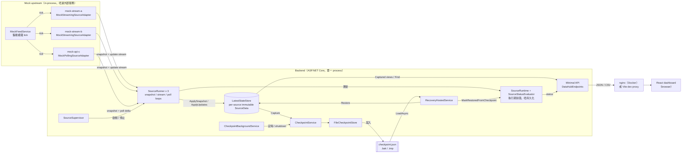
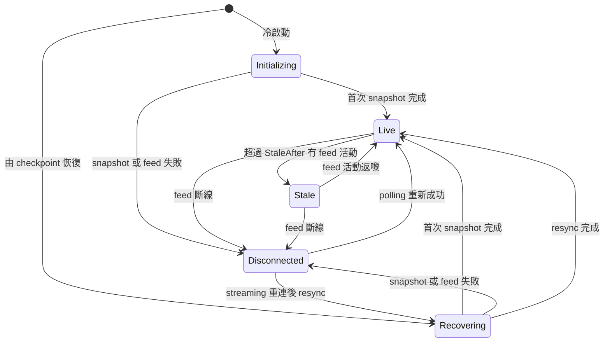
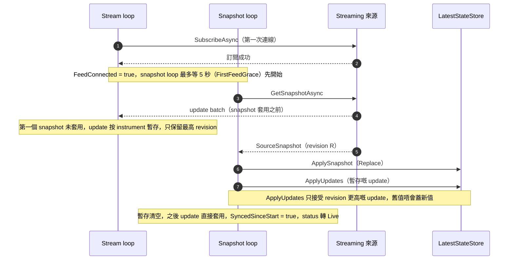
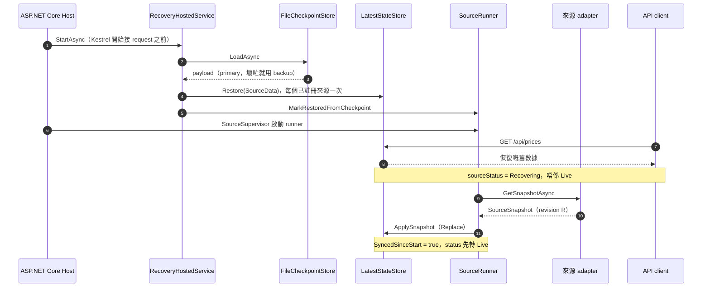
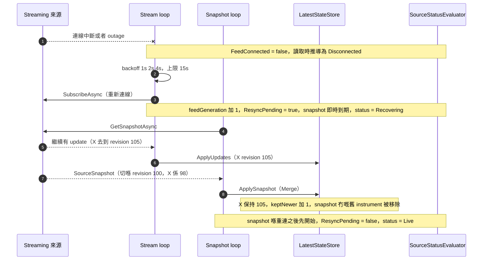
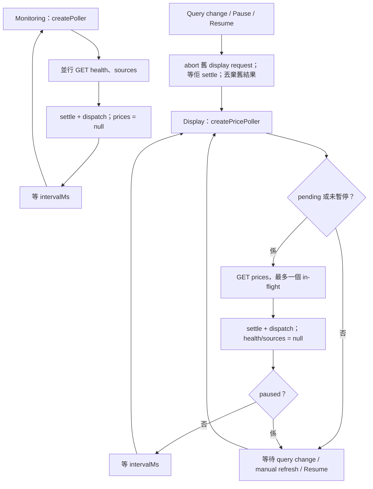
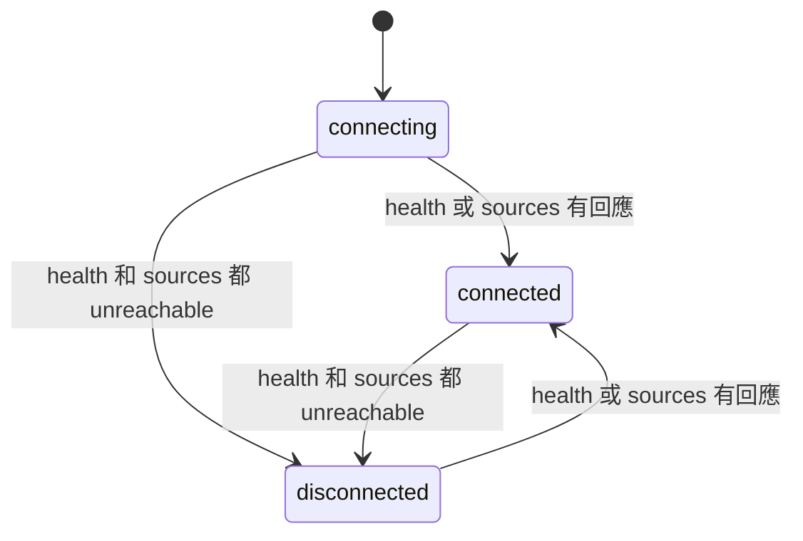
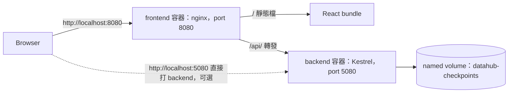

# Data Hub PoC 技術設計文件

> 呢份係**技術設計文件**，講設計、語義同取捨；點樣啟動、指令同 port 清單請睇 [README.md](../README.md)。
> 內容對應實際交付嘅程式碼：class／interface 名稱、設定 key、port 同 API 都以 code 為準。
> 路徑如無特別註明，backend 程式碼相對於 `backend/src/DataHub.Api/`，frontend 相對於 `frontend/src/`。

## 標記

全文用同一套標記區分四種狀態：

| 標記 | 意思 |
|---|---|
| ［已實作］ | 程式碼已經有，並有自動化測試或者實際執行過（見 §11） |
| ［PoC 簡化］ | 為咗 PoC 刻意簡化，或者已知限制；production 前要處理 |
| ［未來］ | 可以擴展，但**今次未實作** |
| ［未驗證］ | 冇實際跑過，或者環境未具備，唔可以當成已驗證（見 §11.3） |

## 目錄

1. [系統目的與範圍](#1-系統目的與範圍)
2. [技術選型](#2-技術選型)
3. [系統架構](#3-系統架構)
4. [數據模型](#4-數據模型)
5. [核心流程](#5-核心流程)
6. [Concurrency 與一致性](#6-concurrency-與一致性)
7. [Persistence 與 recovery](#7-persistence-與-recovery)
8. [API specification](#8-api-specification)
9. [Frontend 設計](#9-frontend-設計)
10. [Configuration 與 deployment](#10-configuration-與-deployment)
11. [測試與驗證](#11-測試與驗證)
12. [已知限制與後續接駁](#12-已知限制與後續接駁)

---

## 1. 系統目的與範圍

### 1.1 目的

Data Hub 係 multi-source、multi-model Trading Data Hub；equity latest-state prices 同 bounded recent-news metadata 係目前兩個示範產品。Data product／model、source system／provider、transport／ingestion mechanism 要分開：Solace 係 transport，而一個 provider 可以提供多個 model。**目前全部係 in-process synthetic mock，唔連任何真實外部服務**。Barra risk／factor exposures、PnL 同 alpha signals 只係未來方向，未實作；本系統唔係交易執行、booking 或歷史事件平台。

News 經 source-native `MockNewsItem` → 驗證／`NewsMapper` → 獨立 `NewsRecord` → `NewsDto`；唔使用 `PriceRecord`、price revision、snapshot deletion 或 price freshness。身份係 `(SourceId, ArticleId)`；同 ID 更新保留 first-seen，列表未出現唔等於刪除。`NewsStore` 預設上限 500、first-seen retention 7 日，先按 first-seen 再按 source／article ID deterministic eviction；另外有最多 MaxItems 個 identity／first-seen 記錄，避免已過期項目重複 fetch 或重啟後重設年齡。Identity 記錄本身按同一順序有界淘汰，遺忘後再出現可當新項目。失敗保留資料。這是 bounded cache，不是新聞歷史。

`mock-news` 每 5 秒 fetch synthetic records，狀態分開記錄 attempt、successful fetch、latest reliable publication instant、error 同 cache count。成功但冇新文章不等於失連；publication date-only／unknown 不偽造 instant；恢復資料需本 process fetch 成功才 Connected。共用 header 顯示 backend 連線同時鐘，各產品來源狀態分別喺 EQUITIES 同 NEWS 頁顯示。

NEWS SOURCES 面板列出 fetch 狀態、last attempt／success、cache、最新可靠 publication instant 及錯誤；模擬 outage 預設 20 秒，`End outage` 可提早結束。無論自然到期或手動結束，都要等待下一次 background fetch 成功（約最多 5 秒）才顯示 Connected；API 不可達時不把最後已知狀態當作目前連線狀態。

`GET /api/news` 支援 `page`、`pageSize`、`keyword`（標題 contains）、`category`（精確、不分大小寫）、`publishedFrom`／`publishedTo`（inclusive `yyyy-MM-dd`）、`sortDirection=asc|desc`（預設 desc）。日期範圍對 instant 用 UTC 日期，date-only 用原日期，unknown 不匹配範圍；未知時間排序永遠最後，日期相同按 instant 排序，最後按 source／article ID 升序。各 request 可見不同 cache 切面。UI 純文字呈現並只開 HTTP(S) URL；無 news CSV。

PoC 要驗證：

1. In-memory latest-state store 作為 API 主要讀取路徑。
2. 多來源並存：同一 InstrumentId 喺唔同來源各有一行，唔會互相覆蓋。
3. 完整 snapshot（預設每星期）同持續 update 嘅協調：snapshot 唔會蓋走較新嘅 update。
4. Checkpoint 檔案 + 重啟恢復；恢復嘅舊數據**未重新同步之前唔會標示為 Live**。
5. API 同 dashboard 如實展示 freshness／recovery 狀態。

### 1.2 點解唔保存中間 tick

- 用例係「而家係幾多」：收到 100 → 101 → 100，最後提供 100 就足夠。唔需要 tick history、event sourcing 或完整事件重播。
- Price store 大小同 **instrument 數量**成正比，唔會隨 update 次數增長；news cache 則另有 retention 同 count 上限。
- Hub 漏咗中間 update 唔致命：下一個 snapshot 會追返最新狀態。前提係**唔可以將過時數據默認標示成最新**，所以 §4.5 定義咗 `Recovering`／`Stale`／`Disconnected`。
- 代價（亦係設計取捨）：
  - UI polling 只反映兩次讀取之間嘅**淨變化**，唔係每個 tick（§9.4）。
  - Polling 來源會合併中間變動：同一 instrument 兩次 poll 之間變咗幾次，只見到最新一次。
  - 冇歷史、冇 as-of 查詢，亦冇法由 Hub 重建過去某刻嘅狀態。

### 1.3 Non-goals

- 歷史／時序資料庫（tick history、as-of 查詢、audit trail）。
- Booking、trade processing、OMS、position／PnL 計算。
- 跨來源嘅「最佳價」合併或仲裁：同一 InstrumentId 嘅不同來源原樣並列。
- HA、多 instance、分散式 cache。
- 認證／授權（PoC admin endpoints 冇保護，見 §8.6）。
- 連接真實 Solace、MSCI／Barra API、MSSQL。

### 1.4 範圍總覽

| 範圍 | 狀態 |
|---|---|
| In-memory latest-state store（per-source、per-instrument） | ［已實作］ |
| 三個 mock price sources（2 個 streaming + 1 個 polling）及一個 synthetic mock news source | ［已實作］ |
| Snapshot：啟動、每星期、手動、feed 重連後 resync | ［已實作］ |
| 本機檔案 checkpoint + 啟動恢復 | ［已實作］ |
| Freshness／recovery 狀態（Initializing／Live／Recovering／Stale／Disconnected） | ［已實作］ |
| REST API + OpenAPI | ［已實作］ |
| Server-side grid sorting／filters、技術欄 visibility、Pause／Resume、bounded CSV export | ［已實作］（Prompt 2） |
| React dashboard、Dockerfiles、Docker Compose | ［已實作］ |
| CNFIN news discovery／adapter | 調查完成；接入 blocked／未啟用（§12.1） |
| 真實 Solace／MSCI／Barra adapter、MSSQL persistence | ［未來］ |
| 認證授權、監控告警、HA、容量測試 | ［未來］ |

---

## 2. 技術選型

### 2.1 實際版本

以下版本係實際安裝或者驗證過嘅（取自 `dotnet --list-sdks`／`--list-runtimes`、`npm ls`、`docker version`、`backend/Directory.Packages.props` 同 container 內指令輸出）。全部係正式版本，冇 preview／RC 後綴。

| 層 | 項目 | 版本 | 備註 |
|---|---|---|---|
| Backend | .NET SDK | 10.0.403 | `backend/global.json` 要求 10.0.100 或以上（`rollForward: latestFeature`，唔接受 prerelease） |
| Backend | .NET／ASP.NET Core runtime | 10.0.14 | 本機同 `mcr.microsoft.com/dotnet/aspnet:10.0` container 都係 10.0.14 |
| Backend | Web API | ASP.NET Core minimal API、`Microsoft.AspNetCore.OpenApi` 10.0.14 | OpenAPI document 喺 `/openapi/v1.json` |
| Backend | `Swashbuckle.AspNetCore.SwaggerUI` | 10.3.1 | 只用 UI；預設只喺 Development 或 `Api:SwaggerUiEnabled` 開啟 |
| Backend tests | xunit／xunit.runner.visualstudio／Microsoft.NET.Test.Sdk | 2.9.3／3.1.4／17.14.1 | |
| Backend tests | Microsoft.AspNetCore.Mvc.Testing／Microsoft.Extensions.TimeProvider.Testing／coverlet.collector | 10.0.14／10.11.0／6.0.4 | 用 `FakeTimeProvider` 驅動時間，唔靠長 sleep |
| Frontend | Node.js | 目標 24 LTS | `frontend/.nvmrc` = `24`、`engines.node` >= 24、Docker build 用 `node:24-alpine`（v24.22.2／npm 11.19.1），喺呢個 Linux container 入面跑過 `npm ci`、lint、test、build。**本機（Windows）實際係 v26.12.0／npm 11.20.0**；Windows 本機 Node 24 未驗證，見 §11.3 |
| Frontend | React／React DOM | 19.3.1 | 唯一兩個 runtime dependency |
| Frontend | TypeScript | 7.0.2 | `npm run build` 入面 `tsc -b` 做型別檢查 |
| Frontend | Vite／@vitejs/plugin-react | 8.3.6／6.2.1 | |
| Frontend | vitest／oxlint | 5.1.0／1.91.0 | 單元測試／lint |
| Runtime | nginx | `nginxinc/nginx-unprivileged:stable-alpine`（驗證時 1.30.6） | 提供靜態檔同 `/api/` reverse proxy |
| Runtime | Docker | 29.9.2（Linux containers） | 只驗證 Linux containers，見 §10.6 |

### 2.2 選擇原因

- **C#／.NET 10／ASP.NET Core**（專案指定）：`BackgroundService`／`IHostedService` 啟停次序清晰，適合 source sync 同 checkpoint；`TimeProvider` 令時間可注入，測試唔使 sleep；`System.Collections.Immutable` 令 store 可以 lock-free 讀取（§6.1）。
- **Minimal API + record DTO**：endpoint 少（§8.1），唔需要 MVC controller。
- **React 19／TypeScript／Vite**（專案指定）：唔用大型 UI framework 或付費 grid；terminal theme 用自家 CSS variables（§9.2）。每頁最多 200 行（§9.6），唔需要 virtualization。
- **唔用 state management library**：`useReducer` + 自家 sequential poller 已經夠（§9.3）。
- **JSON checkpoint 檔案**：可以人手檢查、跨平台、冇額外依賴；checkpoint 只係加速恢復嘅快取，唔係 source of truth（§7）。

### 2.3 基建限制

- 專案規則：**唔新增** Redis、PostgreSQL、Kafka 或其他額外數據庫、message broker、基建服務。Docker Compose 只有 `backend` 同 `frontend` 兩個 service。
- 目標環境嘅現有資源（Windows Server 2022、一部 256 GB RAM 伺服器、MSSQL Server 2022、Network Share、外部 API、Solace）**今次全部冇連過、冇驗證過**。PoC 全部喺個人電腦上用 mock 運行。
- 所以：持久化 = 本機 JSON checkpoint（§7）；來源 = in-process mock（`MockUpstream`）；跨 process 協調 = 冇（單一 instance）。
- 256 GB RAM：**冇做過任何 benchmark 或記憶體量度**，所以唔宣稱可以充分利用，亦唔提供吞吐量或延遲數字。唯一量度過嘅係 checkpoint 檔案大小（約 4,300 條 record 約 780,000–792,500 bytes，見 §7.1）。

---

## 3. 系統架構

### 3.1 Component／data-flow



重點：

- **來源唔同，輸入合約相同**：每個來源都要有 snapshot；streaming 另外有 update subscription，polling 另外有 `PollAsync(afterRevision)`（§3.2）。Store 同 API 完全唔知道來源係 mock 定真實。
- **寫入只經 `SourceRunner`（同 `RecoveryHostedService`）**：兩者都只喺記憶體操作，唔做 network／disk I/O；API 只讀。
- **Checkpoint 係旁路**：由 `CheckpointService` 擷取 store 切面寫檔；啟動時由 `RecoveryHostedService` 讀返，恢復成「暫時顯示嘅舊數據」，要等來源重新同步先轉做 Live（§4.5）。
- **Status 唔存喺 store**：由 `SourceRuntimeState` 喺讀取時用 `SourceStatusEvaluator` 即時推導，所以 stale 同斷線嘅判斷唔依賴任何事件發生。

### 3.2 組件一覽

| 組件 | 位置 | 職責 | 狀態 |
|---|---|---|---|
| `ISourceAdapter`、`IStreamingSourceAdapter`、`IUpdateSubscription`、`IPollingSourceAdapter` | `Sources/ISourceAdapter.cs` | 來源合約：snapshot（必須）；streaming 嘅 `SubscribeAsync`；polling 嘅 `PollAsync` | ［已實作］ |
| `ISourceCatalog`、`MockSourceCatalog` | `Sources/` | 提供啟用嘅 adapters；係唯一替換點 | ［已實作］ |
| `MockUpstream`、`MockStreamingSourceAdapter`、`MockPollingSourceAdapter`、`MockFeedService` | `Sources/Mock/` | 模擬來源：價格隨機漫步、上市／下市、outage、snapshot 延遲 | ［已實作］（模擬） |
| `SourceRunner` | `Sync/SourceRunner.cs` | 每個來源一個：snapshot／stream／poll loops、staging、resync、backoff；維護 `SourceRuntime` | ［已實作］ |
| `SourceRegistry`、`SourceSupervisor` | `Sync/SourceRegistry.cs` | 為每個 adapter 建立 runner；hosted service 啟停所有 runner | ［已實作］ |
| `SourceRuntime`、`SourceRuntimeState`、`SourceStatusEvaluator` | `Sync/SourceRuntimeState.cs` | 不可變執行期狀態 + 推導 status 嘅純函數 | ［已實作］ |
| `SourceViewService` | `Sync/SourceRegistry.cs` | 組合 descriptor、status、store 數據同 runtime，供 API 讀取 | ［已實作］ |
| `RecoveryHostedService` | `Sync/SourceRegistry.cs` | 啟動時載入 checkpoint 並 `Restore` | ［已實作］ |
| `ILatestStateStore`、`LatestStateStore` | `Store/` | In-memory latest-state：`ApplyUpdates`、`ApplySnapshot`、`Restore`、`Query`、`Find`、`Capture` | ［已實作］ |
| `CheckpointService` | `Persistence/CheckpointService.cs` | 擷取、跳過規則、保存結果同狀態 | ［已實作］ |
| `CheckpointBackgroundService` | `Persistence/` | 定時保存；shutdown 最後保存 | ［已實作］ |
| `ICheckpointStore`、`FileCheckpointStore`、`CheckpointSerializer` | `Persistence/` | 檔案格式、寫入 → 驗證 → 替換、備份、載入回退 | ［已實作］ |
| `DataHubEndpoints`、`Dtos` | `Endpoints/` | REST endpoints、validation、problem+json | ［已實作］ |
| `PriceQueryParameters`、`PriceReadService`、`PricesCsv` | `Endpoints/` | 共用輸入解析、單一時間評估／來源 view、CSV escaping／formatting | ［已實作］ |
| `PriceQueryEngine` | `Store/PriceQueryEngine.cs` | 共用 filter／count／sort／paginate，export cap 同 cancellation | ［已實作］ |
| `AddDataHub`、`UseDataHub` | `Hosting/ServiceCollectionExtensions.cs` | 組裝 DI、middleware、endpoints | ［已實作］ |
| `ContentRootResolver` | `Hosting/ContentRootResolver.cs` | 由其他工作目錄起動 publish 出嚟嘅 DLL 時，搵返 `appsettings.json` 所在目錄 | ［已實作］ |
| `DataHubOptions`、`DataHubOptionsValidator`、`DataHubJson` | `Configuration/` | 設定、啟動驗證、API 同 checkpoint 共用嘅 JSON 設定 | ［已實作］ |
| React dashboard | `frontend/` | 見 §9 | ［已實作］ |
| nginx | `frontend/nginx/` | 靜態檔、SPA fallback、`/api/` reverse proxy、安全 header | ［已實作］ |
| 真實 adapters、其他 `ICheckpointStore` 實作 | — | 見 §12 | ［未來］ |

### 3.3 Hosted service 啟停次序

`AddDataHub` 內嘅註冊次序就係啟動次序，停止次序相反：

| 啟動次序 | Hosted service | 啟動時 | 停止時 |
|---|---|---|---|
| 1 | `RecoveryHostedService` | `StartAsync` 內載入 checkpoint 並 `Restore`，**喺 Kestrel 接受 request 之前完成** | 冇動作 |
| 2 | `CheckpointBackgroundService` | 每 `Checkpoint:IntervalSeconds`（預設 30 秒）保存一次 | `StopAsync` 做最後一次保存（`SaveOnShutdown`；10 秒 timeout） |
| 3 | `MockFeedService` | 驅動所有 mock upstream tick | 停止 tick |
| 4 | `SourceSupervisor` | 啟動所有 `SourceRunner` | 停止 runner |

停止次序（反向）：先停 source sync（唔再寫入 store）→ 停 mock feed → 做最後 checkpoint → recovery（冇動作）。咁最後 checkpoint 擷取到嘅，係 sync 停咗之後嘅穩定狀態。

ASP.NET Core 將 web server（Kestrel）嘅 hosted service 放喺最後註冊，所以自家 hosted services 嘅 `StartAsync` 喺 Kestrel 開始接 request 之前完成，停止時亦喺 Kestrel 停咗之後先停。因此第一個 API response 已經讀到恢復嘅數據。

### 3.4 擴展接縫

- **`ISourceCatalog`**：替換 `AddSingleton<ISourceCatalog, MockSourceCatalog>()` 就可以提供真實 adapters（§12.1）。Store、runner、API 唔使改。
- **`ICheckpointStore`**：現時只有 `FileCheckpointStore`；其他實作（例如 MSSQL）要實作 `LoadAsync`／`SaveAsync` 兩個方法（§12.3，**未實作**）。
- **`TimeProvider`**：全部時間都經 DI 注入，測試用 `FakeTimeProvider`。

---

## 4. 數據模型

### 4.1 Record key 同欄位

Record key = **`(SourceId, InstrumentId)`**。Store 以 `SourceId` 分 slot，slot 內用 `InstrumentId`（ordinal，**大小寫敏感**）做 key。所以唔同來源嘅相同 InstrumentId 住喺唔同 slot，**結構上唔可能互相覆蓋**；API 一律每個來源回傳一行（§8.3）。

`PriceRecord`（`Domain/Models.cs`）：

| 欄位 | 型別 | 語義 |
|---|---|---|
| `SourceId` | `string` | 來源 id，例如 `mock-stream-a` |
| `InstrumentId` | `string` | 來源內嘅 instrument id，例如 `MOCK00001`；ordinal 比較 |
| `Price` | `decimal` | 最新價格；JSON 保留 scale（例如 `117.60`） |
| `Currency` | `string` | 貨幣碼，按來源設定（mock：USD／HKD／EUR） |
| `SourceUpdatedAtUtc` | `DateTimeOffset`（UTC） | **來源**話呢個價格幾時變 |
| `ReceivedAtUtc` | `DateTimeOffset`（UTC） | **Hub** 幾時收到並套用 |
| `SourceRevision` | `long` | 來源本地單調遞增版本（§4.3） |

`PriceUpdate`（`InstrumentId`、`Price`、`Currency`、`SourceUpdatedAtUtc`、`Revision`）係來源送入 Hub 嘅格式；Hub 收到後加上 `SourceId` 同 `ReceivedAtUtc` 成為 `PriceRecord`。

> 呢個簡化模型只係 PoC 示範，唔代表所有 MSCI／Barra 數據都係 price record。真實來源嘅數據形狀要另外建模（§12.2）。［PoC 簡化］

### 4.2 UTC 時間語義

- **所有時間欄位都係 UTC**。JSON 輸出格式係 `yyyy-MM-dd'T'HH:mm:ss.FFFFFFF'Z'`（最多 7 位小數，尾隨 0 會省略）；讀入接受任何 ISO 8601 offset 並轉成 UTC（`Serialization/UtcDateTimeOffsetJsonConverter.cs`）。API 同 checkpoint 檔案共用同一個設定（`DataHubJson`）。
- `SourceUpdatedAtUtc` 用**來源嘅時鐘**，`ReceivedAtUtc` 用 **Hub 嘅時鐘**。兩者唔應該拎嚟比較新舊：判斷新舊一律用 revision（§4.3）。
- UI 嘅時間同 header 時鐘亦都顯示 UTC。
- 每個 list／health response 都帶 `serverTimeUtc`。

### 4.3 Source-local revision／ordering

- 每個來源有自己嘅 `Revision`（`long`）。Streaming update 帶 `PriceUpdate.Revision`；snapshot 帶 `SourceSnapshot.Revision`，等於**切 snapshot 嗰刻**來源嘅 revision。
- **定義**：同一來源內，revision 較大 = 較新。Snapshot revision = R 代表「包含所有 revision ≤ R 嘅變更」；因此喺 snapshot 入面冇出現、而 revision ≤ R 嘅 record，代表喺切面嗰刻已經唔係成員（§6.3）。
- **跨來源唔可比較**：`mock-stream-a` revision 697 同 `mock-api-c` revision 1 冇任何先後意義。Store 只喺同一來源 slice 內比較 revision。
- **Mock 嘅 revision 每次 process 啟動都由 1 重新開始**。所以 checkpoint 內嘅 revision 屬於「上一個 session」，**唔可以**同新 session 嘅 revision 比較。因此每次啟動後嘅**第一個** snapshot 以 `Replace` 套用，而唔係 `Merge`（§5.2、§6.3）。
- 真實來源嘅 revision／序號能力要另外確認（§12.2）。

### 4.4 Per-source metadata

**持久化部分**（`SourceData`，`Store/StoreModels.cs`）：同 records 放喺**同一個不可變物件**入面，所以 checkpoint 擷取到嘅 metadata 同 records 一定屬同一刻（§6.4）。

| 欄位 | 語義 |
|---|---|
| `Records` | `ImmutableSortedDictionary<string, PriceRecord>`，key = `InstrumentId`（ordinal 排序） |
| `SnapshotRevision` | 最近一次套用嘅 snapshot revision；用嚟拒絕「已被 snapshot 移除嘅 key」嘅遲到 update（§6.2） |
| `LastSnapshotAtUtc` | 最近一次 snapshot 套用時間 |
| `LastUpdateReceivedAtUtc` | 最近一次有實際套用嘅 update 嘅收到時間 |

**執行期部分**（`SourceRuntimeState`，`Sync/SourceRuntimeState.cs`）：**唔持久化**，每次 process 啟動由初始值重新開始。呢個正正係「恢復數據唔會未同步就係 Live」嘅機制：`SyncedSinceStart` 一定由 `false` 開始。

| 欄位 | 語義 |
|---|---|
| `RestoredFromCheckpoint` | 資料係由 checkpoint 恢復；**成個 process 生命週期都保持 true**（即使之後已經同步，API 仍然顯示，方便辨認呢批數據經過恢復） |
| `SyncedSinceStart` | 今次啟動之後，係咪已經成功完成過一次來源 snapshot |
| `FeedConnected` | Streaming：訂閱中；Polling：最近一次 poll／snapshot 成功 |
| `ResyncPending` | Feed 重新連線後，仲未有一個「喺連線之後先開始」嘅 snapshot 去補返可能漏咗嘅 update |
| `SnapshotInProgress` | 而家有 snapshot 喺度行 |
| `LastFeedActivityAtUtc` | 最近一次 feed 活動（收到 batch／heartbeat、連線成功、poll 成功） |
| `LastSnapshotAttemptAtUtc`、`NextSnapshotDueAtUtc` | 最近一次 snapshot 嘗試時間、下次預定時間 |
| `LastSnapshotError(+AtUtc)`、`ConsecutiveSnapshotFailures` | Snapshot 失敗資訊 |
| `LastFeedError(+AtUtc)`、`ConsecutiveFeedFailures` | Feed 失敗資訊 |

`SourceRuntimeState` 係不可變 record，每次變更都經 `SourceRuntime.Update` 替換成新 instance（寫入用小 lock；讀取用 `Volatile.Read`），所以 API 讀取時永遠見到一致嘅欄位組合。

### 4.5 Freshness／recovery 狀態

`SourceStatus`：`Initializing`、`Live`、`Recovering`、`Stale`、`Disconnected`。狀態由 `SourceStatusEvaluator.Evaluate(state, nowUtc, staleAfter)` 純函數推導，**唔係儲存喺任何地方**。

| 狀態 | 條件 | 數據可信度 | UI 標籤 |
|---|---|---|---|
| `Initializing` | 今次啟動未完成 snapshot、冇由 checkpoint 恢復、冇失敗記錄 | 冇數據 | `INIT` |
| `Recovering` | (a) 由 checkpoint 恢復，但今次啟動未成功 sync；或 (b) 已 sync，但 feed 重新連線後 resync 未完成 | 恢復嘅值屬上個 session；重連空檔期間可能漏咗 update | `RECOVERING` |
| `Live` | 已 sync、feed 連線、冇待處理 resync、而且最近 `StaleAfter` 內有 feed 活動 | 最新 | `LIVE` |
| `Stale` | 已 sync、feed 連線、冇 resync，但 `LastFeedActivityAtUtc` 距今超過 `StaleAfter` | Feed 靜晒但連線未斷，數值可能過時 | `STALE` |
| `Disconnected` | (a) 未 sync 而 snapshot／feed 有失敗記錄；或 (b) 已 sync 但 feed 斷線 | 只係最後已知值 | `DISCONNECTED` |

推導規則：

| 次序 | 條件 | 結果 |
|---|---|---|
| 1 | `!SyncedSinceStart` 而且 snapshot 或 feed 連續失敗 > 0 | `Disconnected` |
| 2 | `!SyncedSinceStart` 而且 `RestoredFromCheckpoint` | `Recovering` |
| 3 | `!SyncedSinceStart` | `Initializing` |
| 4 | `!FeedConnected` | `Disconnected` |
| 5 | `ResyncPending` | `Recovering` |
| 6 | `StaleAfter > 0` 而且 `now - LastFeedActivityAtUtc > StaleAfter` | `Stale` |
| 7 | 其他 | `Live` |

**不變式**：`Live` 一定要 `SyncedSinceStart = true`。換言之，由 checkpoint 恢復嘅數據，未成功完成今次啟動嘅 snapshot 之前，**永遠唔會係 `Live`**。

`StaleAfter` 嘅實際值：預設 `Freshness:StaleAfterSeconds` = 30；polling 來源取 `max(設定值, 3 × PollInterval)`，避免兩次 poll 之間誤報 Stale；設為 0 即停用 Stale 判斷。Streaming 空 batch 視為 heartbeat：只更新 `LastFeedActivityAtUtc`，唔改價格。



上圖係簡化版，只畫主要轉換；完整規則以上面嘅推導表為準。例如未 sync 嘅 `Disconnected` 喺失敗記錄清零之後，亦可以回到 `Initializing`／`Recovering`。

`Stale` 只反映「最近有冇 feed 活動」，**唔代表數值錯**；亦只喺讀取時計算，所以就算冇任何事件發生，過咗期限一樣會變 `Stale`。［PoC 簡化］

---

## 5. 核心流程

每個來源由一個 `SourceRunner` 負責，**來源之間互相獨立**：一個來源失敗唔會影響其他來源（`OneFailingSource_DoesNotAffectTheOthers_AndRecoversOnItsOwn`、`OneFailingSource_DoesNotAffectTheOther_AndSameInstrumentIdsNeverOverwriteEachOther` 兩個測試）。

### 5.1 冷啟動（冇 checkpoint）

1. `RecoveryHostedService` 搵唔到可用 checkpoint（或者 `Checkpoint:Enabled=false`），記一行 log，store 保持空，所有來源 `Initializing`。
2. `SourceSupervisor` 啟動各個 `SourceRunner`；每個 runner 各自開 snapshot loop 同 stream／poll loop。
3. **Streaming 來源**：
   - stream loop 先連線並 `SubscribeAsync`；
   - snapshot loop 等第一次 feed 嘗試完成（成功或者失敗，最多等 5 秒 `FirstFeedGrace`）先攞 snapshot，所以**訂閱一定喺 snapshot 之前**；
   - snapshot 套用之前收到嘅 update 按 instrument 暫存（staging，只保留最高 revision）；
   - 第一個 snapshot 以 `Replace` 套用，再將暫存嘅 update 逐個套用，之後 update 直接套用（序列圖 B）。
4. **Polling 來源**：先攞 snapshot（`Replace`），以 snapshot revision 作為 poll cursor，之後每個 `PollInterval` poll 一次。Polling 冇 staging。
5. 第一個 snapshot 完成之前，API 回傳 `Initializing` 同 0 行（`FirstSync_IsInitializingUntilTheSnapshotIsApplied_ThenLive` 測試）。



序列圖 B：Streaming 來源嘅第一個 snapshot（staging → `Replace` → 排乾暫存）。

### 5.2 暖啟動（由 checkpoint 恢復）

1. `RecoveryHostedService.StartAsync` 載入 checkpoint：primary → `.bak` → 冇。損壞唔會令啟動失敗，只會記 warning 並由 `/api/health` 嘅 `checkpoint.loadWarnings` 回報（§7.4）。
2. 對 checkpoint 內每個**已註冊**嘅來源：`store.Restore(SourceData)`，同時 `runner.MarkRestoredFromCheckpoint()`。未註冊嘅 sourceId 會被忽略並記 warning；checkpoint 冇包含嘅來源保持冷啟動（`Initializing`）（`OnlyTheSourcesInTheCheckpointAreRecovering_TheOthersStayInitializing`、`ASourceThatIsNoLongerRegistered_IsIgnoredWithAWarning` 測試）。
3. 恢復完成之後 Kestrel 先接受 request（§3.3）。呢個時候 API 已經回傳恢復嘅數據，但每行 `sourceStatus` 都係 **`Recovering`**，唔係 `Live`。
4. Runner 照 §5.1 步驟 3／4 同步；第一個 snapshot 以 `Replace` 換走成個恢復內容；成功後 `SyncedSinceStart = true`，status 先轉 `Live`（`RestoredData_IsServedAsRecoveringAndNeverLive_UntilTheFirstSnapshotReplacesIt` 測試）。
5. 如果來源喺恢復之後攞唔到 snapshot（例如來源 down），status 係 `Disconnected`，**仍然提供恢復嘅最後已知值**，但清楚標示唔係 Live；來源返嚟之後自動 resync（`RestoredData_WhenTheSourceIsDown_IsDisconnectedButStillServed_ThenReplacedOnRecovery` 測試）。



序列圖 A：啟動恢復。

### 5.3 每星期 snapshot（scheduled）

- 每個來源嘅 snapshot loop 每 250 ms 檢查一次 `NextSnapshotDueAtUtc`；未設定或者已到期，就行 `RefreshSnapshotAsync(Scheduled)`。
- 成功後 `NextSnapshotDueAtUtc = 套用時間 + Snapshot:IntervalHours`（預設 168 小時 = 7 日）。
- 失敗：舊數據照常提供，記錄 `LastSnapshotError`，以指數 backoff 重試（`Snapshot:RetryInitialDelaySeconds` 預設 1 秒起、倍增、上限 `RetryMaxDelaySeconds` 預設 15 秒）。
- 第一個 snapshot 之後嘅 snapshot 一律以 `Merge` 套用（§6.2、§6.3）。
- **驗證範圍**：排程邏輯由 `ScheduledSnapshots_RunAtTheConfiguredInterval` 用 `FakeTimeProvider` 驗證；**冇真實等過 168 小時**。想觀察 snapshot 行為可以用手動 snapshot（§5.6）。

### 5.4 Streaming／polling 持續更新

**Streaming**（`mock-stream-a`、`mock-stream-b`）：

- 每個 batch 經 `ApplyLive`：第一個 snapshot 完成前暫存，之後 `store.ApplyUpdates`。**空 batch 係 heartbeat**，只更新 `LastFeedActivityAtUtc`（`Heartbeat_KeepsTheSourceFresh_AndSilenceBecomesStale` 測試）。
- Stream 結束或者出錯：`FeedConnected = false`（status → `Disconnected`），`ConsecutiveFeedFailures` 加 1，按指數 backoff 重連（1 秒起、倍增、上限 15 秒；`StreamReconnect_BacksOffExponentiallyAndCapsAtTheMaximum` 測試）。
- **每次重新連線成功都當作「可能漏咗 update」**：`ResyncPending = true`、即刻安排一個 snapshot、status → `Recovering`；直至一個「喺連線**之後**先開始」嘅 snapshot 套用完成，先回到 `Live`（序列圖 C；`DroppedConnection_ReconnectsAndNeverReportsLiveUntilResynced` 測試）。
- Feed 一開始就唔可用：仍然會攞 snapshot（`FeedDownAtStartup_StillTakesTheSnapshot_AndResyncsOnceTheFeedReturns` 測試），status 係 `Disconnected`，feed 返嚟之後 resync。
- Mock 嘅 subscriber queue 上限 1024 個 batch；消費太慢會令 subscription fault（`Subscriber too slow: update queue overflow.`），行同一條重連 + resync 路徑。

**Polling**（`mock-api-c`）：

- 每個 `PollInterval`（`mock-api-c` = 5 秒）呼叫 `PollAsync(cursor)`，只攞 revision 大過 cursor 嘅 instrument；同一 instrument 喺兩次 poll 之間嘅多次變動合併成最新一次。
- 成功：`ApplyUpdates`、cursor 單調前進（`AdvancePollCursor`）、`FeedConnected = true`。失敗：`Disconnected`，backoff 後重試；成功之後直接返 `Live`，**冇 `ResyncPending`**，因為 poll 本身就係按 cursor 補返差額（`PollFailure_IsDisconnected_ThenRecoversWithTheDeltaItMissed` 測試）。
- Polling **睇唔到刪除**，只可以靠下一個完整 snapshot 移除（§6.3）。



序列圖 C：斷線 → 重連 → resync snapshot（`Merge`）→ 回到 `Live`。

### 5.5 Checkpoint 保存

- **定時**：`CheckpointBackgroundService` 每 `Checkpoint:IntervalSeconds`（預設 30 秒）保存一次。如果 store `Version` 同上次成功保存相同就跳過（`SkippedUnchanged`）；store 完全冇數據又冇 snapshot 記錄就唔寫（`SkippedEmpty`），所以**永遠唔會用空 checkpoint 蓋走舊檔**（`NothingLoadedOrSynced_IsNeverWritten` 測試）。
- **手動**：`POST /api/admin/checkpoint`，唔使「冇變更就跳過」（`ManualSave_AlwaysWrites_EvenWhenNothingChanged`）；已有保存進行中就回 `Busy`（HTTP 409）。
- **Shutdown**：見 §5.7。
- 寫入順序同保證見 §7.3。

### 5.6 手動 snapshot

`POST /api/admin/snapshot/{sourceId}`：

- 同一來源同一時間只准一個 snapshot（`SemaphoreSlim(1,1)` + `WaitAsync(0)`）；重疊就回 `AlreadyRunning` → HTTP 409，**唔會再打來源**（`ManualRefresh_WhileASnapshotIsRunning_ReturnsAlreadyRunningWithoutHittingTheSource` 測試）。
- 成功：HTTP 200 + 套用摘要（`added`／`updated`／`removed`／`keptNewer`／`totalRecords`／`skipped`）。來源失敗：HTTP 502，舊數據保留（`FailedSnapshot_KeepsServingTheOldData_AndRecordsTheError`）。來源 id 唔存在：404。
- 如果呢個係今次啟動之後第一個成功套用嘅 snapshot，一樣以 `Replace` 套用。
- Handler 用 `ApplicationStopping` 而唔係 `RequestAborted`：client 中途斷線唔會中斷進行中嘅 snapshot／checkpoint。

### 5.7 Shutdown

Ctrl+C、SIGTERM 或者 `docker compose stop` 之後：

1. Host 觸發 `ApplicationStopping`，然後按**註冊次序嘅反向**停止 hosted services：web server → `SourceSupervisor` → `MockFeedService` → `CheckpointBackgroundService` → `RecoveryHostedService`（§3.3）。
2. `CheckpointBackgroundService.StopAsync` 做最後一次保存：`CheckpointTrigger.Shutdown`，會等進行中嘅保存完成，10 秒 timeout；`Checkpoint:SaveOnShutdown=false` 可以關閉。
3. Host 整體 shutdown timeout 係 .NET 預設嘅 30 秒（`HostOptions.ShutdownTimeout`，今次冇改動）；Compose 嘅 `stop_grace_period` 同樣係 30 秒。
4. 強制終止（`docker kill`、斷電、process crash）**冇**最後 checkpoint，只剩最近一次定時 checkpoint（§7.5）。

> 啟動次序已用實際 startup log 確認（`RecoveryHostedService`、`CheckpointBackgroundService`、`SourceSupervisor` 嘅 log 都出現喺 `Now listening on` 之前）。停止次序係由 Microsoft Learn 記載嘅「hosted services 按註冊次序反向停止」推導，冇逐個 service 用 log 量度。實際驗證過嘅係：Windows `dotnet run` Ctrl+C 同 `docker compose stop` 之後都寫出最後 checkpoint，下次啟動成功恢復。

---

## 6. Concurrency 與一致性

### 6.1 Thread safety

| 共享狀態 | 寫入者 | 讀取者 | 機制 |
|---|---|---|---|
| 每個來源嘅 `SourceData`（records + metadata） | `SourceRunner`（update／snapshot）、`RecoveryHostedService`（`Restore`） | API、`Capture()` | **不可變物件**。寫入者持有該來源嘅 `WriteLock`，用 `ToBuilder()` 建新版本，再 `Volatile.Write` 發佈；讀取者 `Volatile.Read`，**唔使上鎖** |
| `LatestStateStore.Version` | 每次真正改動 store 嘅寫入 | `CheckpointService` | `Interlocked.Increment`；讀取 `Volatile.Read` |
| `SourceRuntimeState` | `SourceRunner` 各 loop | API | 不可變 record；`SourceRuntime.Update(Func)` 喺小 lock 內替換；讀取 `Volatile.Read` |
| Staging 暫存 | stream loop（`ApplyLive`）、snapshot loop（`ApplySnapshot`） | 同左 | `_stageLock`：「檢查／寫入暫存」同「排乾暫存 + 轉做直接套用」互斥，冇 update 會喺轉換之間漏失 |
| Snapshot 執行權 | scheduled loop、手動 endpoint | — | `SemaphoreSlim(1,1)` + `WaitAsync(0)`：已有 snapshot 就即刻回 `AlreadyRunning` |
| Checkpoint 執行權 | 定時、手動、shutdown | — | 單一 save gate；非 shutdown 用 `WaitAsync(0)`（`Busy`），shutdown 會等 |
| Loop 崩潰 | `Supervise` | — | 未預期例外記 Critical log，5 秒後重啟該 loop，唔會令整個 process 死 |
| Mock subscriber queue | `MockUpstream.Tick` | stream loop | Bounded channel（1024 batch，`FullMode=Wait`）；滿咗就令 subscription fault，走重連 + resync |

重點：

- **API 讀取路徑冇 lock，亦唔會被 snapshot 或者 checkpoint 阻塞**。Snapshot 喺 lock 外面準備好，只喺最後套用時短暫持有該來源嘅 `WriteLock`。
- 寫入只喺記憶體操作，唔會喺持有 lock 時做 network 或者 disk I/O。
- `ConcurrentWritersAndReadersStayConsistent` 測試令多個 writer 同 reader 同時操作，驗證讀取到嘅 slice 內部一致。

### 6.2 Snapshot 對比較新嘅 update

Snapshot 喺來源切面後要經網絡傳輸（mock 設定 200–400 ms 延遲），期間 live update 照常到達並已經套用。Store 用 **source revision** 解決衝突，唔用時間：

**單一 update（`ApplyUpdates`）**

| 情況 | 處理 |
|---|---|
| InstrumentId 空白 | 忽略 |
| Key 已存在 | 只有 `Revision > existing.SourceRevision` 先套用；相同或者更舊就忽略 |
| Key 唔存在 | 只有 `Revision > SnapshotRevision` 先套用（新上市）；否則忽略，**避免遲到嘅舊 update 令已被 snapshot 移除嘅 key 復活** |
| 有任何 update 實際套用 | 設定 `LastUpdateReceivedAtUtc`、`Version` 加 1；全部被忽略就唔改 `Version` |

**Snapshot（`ApplySnapshot`）**

| 情況 | `Merge`（第一個之後嘅 snapshot） | `Replace`（每次啟動後第一個） |
|---|---|---|
| Snapshot 內重複 InstrumentId | 取最高 revision；空 id 丟棄 | 同左 |
| `snapshot.Revision` < 已套用嘅 `SnapshotRevision` | **整個 snapshot 略過**（`skipped: true`） | 唔適用（內容直接換走） |
| Snapshot 嘅 revision 較高 | 更新 | 內容變成 snapshot |
| Snapshot 嘅 revision 較低（live update 較新） | **保留現有值**，計入 `keptNewer` | 唔適用 |
| Store 有、snapshot 冇 | 只有現有 `revision <= snapshot.Revision` 先移除；較新嘅（snapshot 切完之後先出現）保留 | 移除 |
| Store 冇、snapshot 有 | 新增 | 新增 |
| 套用後 | 設定 `SnapshotRevision`、`LastSnapshotAtUtc`，`Version` 加 1 | 同左 |

例子：Snapshot 切喺 revision 100。喺 snapshot 傳輸期間：

- 現有 X 已經因為 live update 去到 revision 105，而 snapshot 內 X 係 revision 98 → Merge 保留 105，`keptNewer` 加 1。
- 新上市嘅 Y（revision 103）snapshot 冇 → 103 > 100，保留，唔會當成「已移除」。
- 舊成員 Z（revision 60）snapshot 冇 → 60 <= 100，移除。

對應測試：`SnapshotMerge_DoesNotOverwriteNewerUpdates`、`SnapshotMerge_KeepsInstrumentsListedAfterTheSnapshotWasCut`、`SnapshotMerge_AddsUpdatesAndRemovesMembers`、`SnapshotMerge_OlderThanTheAppliedSnapshotIsSkipped`、`LateOldUpdateCannotResurrectAnInstrumentRemovedBySnapshot`。實際 API 觀察（單次執行，唔係 benchmark）：將 `mock-stream-b` 嘅 snapshot 延遲拉長到 12 秒，手動 snapshot 回報 `keptNewer: 391`，即係 snapshot 傳輸期間有 391 個 instrument 已經有比 snapshot 更新嘅 live 值，全部冇被蓋走。

### 6.3 成員變動（上市／下市／removal）

- **Streaming update 只代表「新增或者價格變動」，冇 delete 訊息**；mock 嘅下市亦刻意**唔**經 stream 通知。所以下市嘅 instrument 只可以由下一個 snapshot 嘅 `Merge` 移除（「snapshot 冇 + revision <= 切面 revision」）。
- Polling 睇唔到刪除，同樣要靠 snapshot（`PollingCannotSeeDeletions_SoTheNextFullSnapshotRemovesThem` 測試）。
- 被 snapshot 移除嘅 key，遲到嘅舊 update 唔會令佢復活（見 §6.2）。
- Hub **冇 tombstone**，只記住 `SnapshotRevision` 做下限。
- **後果**：已下市嘅 instrument 最多會保留到下一個 snapshot（預設 7 日）；喺呢段時間 API 會繼續回傳佢嘅最後一個價格。手動 snapshot 可以即時清理。［PoC 簡化］
- 啟動後第一個 snapshot 用 `Replace`：恢復嘅內容整個換走，包括已下市嘅 instrument。

### 6.4 Checkpoint 一致性

`LatestStateStore.Capture()`：

1. **先讀 `Version`**，再逐個來源讀 `SourceData` 引用。
2. 每個來源嘅 `SourceData` 係不可變物件，records 同 `SnapshotRevision`／`LastSnapshotAtUtc`／`LastUpdateReceivedAtUtc` 喺同一個物件入面，所以 **單一來源嘅 checkpoint 內容一定係一個完整、內部一致嘅版本**（`Capture_IsAStableViewThatLaterWritesDoNotChange` 測試）。
3. 唔同來源係先後讀取，中間 writer 照常寫入，所以**跨來源只係 fuzzy**：檔案可能包含來源 A 較早、來源 B 較遲嘅狀態。Hub 本身亦冇提供跨來源一致性（§6.5），所以呢點唔影響任何保證。
4. 因為 `Version` 先讀，檔案內容可能**比 `checkpointVersion` 更新，但唔會更舊**；`SkippedUnchanged` 判斷因此只會多寫一次，唔會漏寫。
5. 保存期間唔阻塞任何 writer 或者 reader（唔使 stop-the-world）。
6. `SourceRuntimeState`（狀態、錯誤、cursor）**唔入 checkpoint**；恢復之後一律由 `Recovering` 開始。
7. 恢復之後，checkpoint 內嘅 `sourceRevision` 只係資訊（API 照顯示），**唔會同新 session 嘅 revision 比較**（§4.3）。

### 6.5 Per-source 保證與跨來源限制

**保證（同一來源內）**

- 同一 `(SourceId, InstrumentId)` 嘅值只會向更高 revision 前進，唔會被舊 update 或者舊 snapshot 倒退。
- 讀取者永遠見到某個來源嘅一個完整版本，唔會見到「做咗一半」嘅 snapshot，或者 records 同 metadata 錯配。
- 唔同來源嘅相同 InstrumentId 互相獨立（`SameInstrumentIdFromDifferentSourcesDoesNotOverwrite`、`RevisionsOfDifferentSourcesAreNeverCompared` 測試）。
- `Live` 一定經過今次啟動嘅 snapshot（§4.5 不變式）；`SyncedSinceStart` 只會由 false 變 true，所以呢個保證唔受讀取時序影響。

**限制**

- **冇跨來源一致性**：來源之間冇共同 revision 或者時鐘。`/api/prices` 一頁可以同時包含多個來源，每個來源各自係「讀取時嘅最新」；唔可以拎唔同來源嘅 `sourceRevision` 或者時間互相比較。
- API response 內嘅 rows 同 status 係**分開讀取**（store 切面同 runtime state 唔係單一 atomic read），所以極短時間差內兩者可能剛好差一個狀態轉換。
- **Offset pagination 唔隔離**：預設按 `(SourceId, InstrumentId)` ordinal 排序；亦支援價格、幣別同時間。翻頁期間成員增減或排序欄位更新，都可能令一行重複、漏睇或跳頁。唔同頁／export request **唔係同一個全域 snapshot**。
- `PriceReadService` 每個請求只讀一次 `TimeProvider.GetUtcNow()`，用同一時間評估全部來源 status、status filter、row status、freshness 同 `serverTimeUtc`。`SourceViewService.GetAll(now)` 捕獲各來源嘅 immutable `SourceData` reference 同 runtime view；runtime 同 data 仍然係分開讀，跨來源仍然先後讀取。
- `PriceQueryEngine` 共用 filter → count／sort → paginate 語義。兩次遍歷讀同一批 captured references，序列化期間唔再讀 store；唔持有 writer lock，ingestion 照常。CSV all-matching 只略過 pagination。
- Filter／count 係線性掃描；M 個 matching rows 排序需要 **O(M log M) 時間／O(M) references**，唔再係原本只按固定 key 做 O(offset) 分頁。CSV all-matching 超限會喺排序前拒絕；page export 嘅 row cap 只限制輸出，**唔限制排序全部 matching rows 嘅工作記憶體**。PoC 規模（約 4,300 行）未做性能／容量測試。

### 6.6 Ordering guarantees

`SourceRunner` 提供以下排序保證（code 內嘅 class 註解指向呢節）：

1. **先訂閱 stream，再攞第一個 snapshot**；第一個 snapshot 完成之前，stream update 按 instrument 合併暫存（staging，只保留最高 revision）。咁 snapshot 同訂閱之間唔會有空檔。
2. **第一個 snapshot 以 `Replace` 套用**（舊 checkpoint 嘅 revision 屬於上一個 session，唔可以同新 session 比較），之後先排乾暫存。
3. **Feed 每次重新連線都視為可能漏 update**，即刻再攞一個 snapshot（`Merge`）；期間 status 係 `Recovering`。
4. **所有套用都用 source revision 比較**，所以 snapshot 等待期間先到嘅新 update 唔會被舊 snapshot 蓋走。

呢啲保證建基於以下假設，真實來源接駁時要逐項確認（§12.2）：

- 同一來源嘅 revision 喺 Hub process 生命週期內單調遞增，而且 snapshot revision 同 update revision 可以直接比較。Mock 因為同 Hub 同一個 process，自然滿足。
- 如果來源自己重設 revision（例如來源重啟後由 1 開始），而 Hub 一直行緊，之後嘅 update 會被當成舊資料忽略，較低 revision 嘅 snapshot 亦會被略過，直至 revision 追過 Hub 已記住嘅值。**呢個情況冇處理**，要由 adapter 負責（例如加 epoch 轉換成單調 revision）。［PoC 簡化］
- 相同 revision 但內容唔同（來源 bug）唔會被偵測；相同 revision 視為 no-op。

---

## 7. Persistence 與 recovery

Checkpoint 只係**加速恢復嘅本機快取**，唔係 source of truth。真正嘅最新狀態喺來源；Hub 重啟後最終一定靠來源嘅 snapshot 追返（§7.6）。

### 7.1 格式同位置

**位置**（`Checkpoint:Directory`，預設 `data/checkpoints`；相對路徑以 content root 為基準，絕對路徑原樣使用）：

| 運行方式 | 實際位置 |
|---|---|
| `dotnet run`／Visual Studio F5 | `backend/src/DataHub.Api/data/checkpoints/` |
| `dotnet publish` 出嚟再行 | `<publish 目錄>/data/checkpoints/` |
| Docker Compose | container 內 `/var/lib/datahub/checkpoints`（named volume `datahub-checkpoints`，Compose project 名 `datahub-poc`，所以 volume 全名係 `datahub-poc_datahub-checkpoints`） |

目錄內有三個檔案（檔名取自 `Checkpoint:FileName`，預設 `checkpoint.json`；必須係純檔名，唔可以夾路徑）：

| 檔案 | 用途 |
|---|---|
| `checkpoint.json` | 最新 checkpoint（primary） |
| `checkpoint.json.bak` | 上一個完好嘅 checkpoint |
| `checkpoint.json.tmp` | 保存途中嘅暫存檔；保存成功就變成 primary，所以平時唔存在 |

**格式**：目前輸出 UTF-8 compact JSON、`schemaVersion` = 2，額外有 `news` 同 `newsSha256`。Schema 1 price-only 檔仍可讀、news 為空；未知未來 schema 會發 warning 並阻止保存，避免覆寫 primary 或 backup。以下係舊 schema 1 結構示例（縮排同省略係為咗易讀）：

```json
{
  "schemaVersion": 1,
  "checkpointVersion": 177,
  "savedAtUtc": "2026-11-05T18:59:18.1312766Z",
  "recordCount": 4300,
  "payloadSha256": "f7ff2e48b44eb6041a9116d3ac8c7ead27464907147edaa86449656e84cf22dd",
  "sources": [
    {
      "sourceId": "mock-api-c",
      "snapshotRevision": 1,
      "lastSnapshotAtUtc": "2026-11-05T18:58:54.1499108Z",
      "lastUpdateReceivedAtUtc": "2026-11-05T18:59:14.1792535Z",
      "records": [
        {
          "instrumentId": "MOCK00001",
          "price": 480.939,
          "currency": "EUR",
          "sourceUpdatedAtUtc": "2026-11-05T18:59:04.1313246Z",
          "receivedAtUtc": "2026-11-05T18:59:04.1625961Z",
          "sourceRevision": 636
        }
      ]
    }
  ]
}
```

| 欄位 | 語義 |
|---|---|
| `schemaVersion` | 目前寫 2，讀 1／2；未來版本不靜默忽略，阻止保存以保護檔案 |
| `checkpointVersion` | 擷取時 store 嘅 `Version`（§6.4） |
| `savedAtUtc` | 保存嘗試嘅時間 |
| `recordCount` | 全部 records 總數；載入時要同實際數量一致 |
| `payloadSha256` | `sources` 原始 JSON bytes 嘅 SHA-256。用嚟偵測**截斷同位元損壞**，**唔係防篡改**（冇金鑰，任何人都可以重算） |
| `sources[]` | 每個來源一項：`SourceData` 嘅持久化部分（§4.4）。按 `sourceId` ordinal 排序，輸出係 deterministic（`Serialize_IsDeterministicRegardlessOfSourceOrder`） |
| `news`／`newsSha256`、`newsIdentities`／`newsIdentitiesSha256` | news records、有限 identity／first-seen 記錄及各自 JSON SHA-256；恢復時重新套用 count／retention。`recordCount` 仍只計價格，保持既有 API 語義 |

觀察（幾次單次保存）：約 4,300 條 record 嘅 checkpoint 約 780,000–792,500 bytes（每條約 181–184 bytes）；保存耗時約 59–136 ms。呢啲只係單次觀察，**唔係 benchmark**。

### 7.2 檔案系統

| 位置 | 狀態 | 備註 |
|---|---|---|
| 本機磁碟（Windows，`dotnet run`、publish） | ［已實作］已實際行過 | 預設設定 |
| Docker named volume（Linux container） | ［已實作］已實際行過 | 包括 `docker compose stop` 後嘅 shutdown checkpoint、重啟恢復、`docker kill` 情境 |
| Docker bind mount | 未驗證 | Windows host 嘅 bind mount 權限同 `File.Replace` 行為要另外測 |
| **Network Share（SMB／UNC）** | ［未來］**未驗證** | `File.Replace`／flush 喺網絡共享上嘅 atomic 同持久性語義要另外測試，唔可以假設同本機磁碟一樣。建議先寫本機磁碟，再另行備份去 share |
| MSSQL | ［未來］未實作 | 見 §12.3 |

額外限制：

- **單一 writer**：冇 instance lock，兩個 Hub instance 唔可以共用同一個 checkpoint 目錄（會互相覆蓋）。［PoC 簡化］
- Atomic replace 依賴檔案系統；若 `File.Replace` 唔係單一 atomic 操作，載入時嘅 backup 回退係第二道防線（§7.4）。

### 7.3 保存流程（`FileCheckpointStore.SaveAsync`）

1. `CheckpointService` 取得 `store.Capture()`，`CheckpointSerializer` 序列化成 bytes（連 `payloadSha256`）。
2. 如果目錄未存在就建立。
3. 寫入 `checkpoint.json.tmp`（`FileMode.Create`、`FileShare.None`、`WriteThrough`），並 flush 到磁碟。
4. **讀返 `.tmp` 驗證**：長度同 SHA-256 要同剛序列化嘅 bytes 一致；唔一致就當保存失敗，**唔會動 primary**。
5. 提升（promote）：
   - Primary 存在而且完好：`File.Replace(tmp, primary, bak)`，舊 primary 變 `.bak`，`.tmp` 變新 primary。
   - Primary 存在但已知損壞：`File.Move(tmp, primary, overwrite)`，**唔會**將損壞檔輪換去 `.bak`，保留原本完好嘅 `.bak`（`CorruptPrimary_IsNotRotatedOverTheGoodBackup_AfterALoad`、`..._EvenWithoutALoad`）。
   - Primary 狀態未知（剛啟動、未載入過）：先驗證，再按上面兩項選擇。
   - 冇 primary：`File.Move(tmp, primary)`。
6. 成功：記錄 bytes、record 數、耗時（`/api/health` 嘅 `checkpoint.lastSuccess*`）。失敗：見 §7.7。

### 7.4 載入同回退（`LoadAsync`）

1. 讀 primary，`CheckpointSerializer.Deserialize` 驗證：`schemaVersion`、`payloadSha256`、重複或者缺失嘅 `sourceId`／`instrumentId`、`recordCount`。成功 → `loadedFrom = "primary"`。
2. Primary 唔存在：唔報 warning，直接試 backup。Primary 損壞或者讀唔到：記 warning，再試 backup。
3. Backup 成功 → `loadedFrom = "backup"`。兩個都唔可用 → 冇 payload，冷啟動，warnings 列喺 `/api/health` 嘅 `checkpoint.loadWarnings`。
4. `.tmp` 殘留一律忽略（可能係保存途中 crash）。
5. **載入絕不 throw，亦唔會阻止啟動**（`BothFilesCorrupt_YieldsNoPayloadButNeverThrows`、`CorruptCheckpoint_NeverBlocksStartup_AndTheNextSaveRepairsIt`）。
6. 由 backup 載入之後，`CheckpointService` 唔會將當前版本記為「已保存」，所以下一次定時保存會修復 primary（`LoadedFromBackup_SavesAgainSoThePrimaryIsRepaired`）；由 primary 載入就唔會即刻重寫一份未變嘅 checkpoint（`LoadedFromPrimary_DoesNotImmediatelyRewriteAnUnchangedCheckpoint`）。

### 7.5 Crash 同損失窗口

| 情況 | 結果 | 恢復之後 |
|---|---|---|
| 正常停止（Ctrl+C、SIGTERM、`docker compose stop`） | 寫入 final checkpoint（§5.7） | 全部來源 `Recovering`，resync 後 `Live` |
| 強制終止、crash、斷電 | 冇 final checkpoint。損失最近一次成功保存之後嘅變動：最多約 `Checkpoint:IntervalSeconds`（預設 30 秒）加上「擷取到寫入完成」之間嘅短暫時間 | 恢復較舊嘅值（`Recovering`），resync 後追返 |
| 保存途中 crash | `.tmp` 殘留；primary 同 backup 唔受影響 | 啟動時忽略 `.tmp`，下次保存覆蓋（`LeftoverTempFileFromACrashedSave_IsIgnored`、`LeftoverTempFile_IsOverwrittenByTheNextSave`） |
| Primary 損壞或截斷 | Warning，用 `.bak`（比 primary 舊一個 checkpoint） | 同上（`CorruptPrimary_FallsBackToTheBackupWithAWarning`、`TruncatedPrimary_IsTreatedAsCorrupt`） |
| Primary 同 backup 都唔可用 | 冷啟動 | `Initializing`，等 snapshot |

呢個「損失」唔係永久資料損失：Hub 係來源嘅衍生 cache，損失只影響「重啟後、首個 snapshot 完成前」嗰段時間顯示嘅舊值有幾舊；snapshot 一到就追返全部最新狀態。

### 7.6 重新取得最新狀態

- 每個來源啟動後嘅第一個 snapshot 以 `Replace` 換走恢復內容（§5.2），完成後先轉 `Live`。
- 時間取決於來源 snapshot 嘅速度：mock 約 0.2–0.4 秒；真實來源未知，要接駁時量度（§12.2）。
- 期間 API 同 UI 都標示 `Recovering`；想用肉眼睇到，可以用 `compose.slow-snapshot.yaml` 拉長 mock snapshot（README §11）。
- 即使冇 checkpoint，一樣由 snapshot 取得最新狀態；checkpoint 只係令「重啟後立即有（舊）數據可睇」。

### 7.7 寫入失敗同來源不可用

| 情況 | 行為 |
|---|---|
| Checkpoint 寫入失敗（磁碟滿、權限、目錄無法建立等） | **唔影響服務**：照舊由記憶體提供。`CheckpointService` 記錄 `lastError`、`consecutiveFailures`，下一個定時 tick 重試，成功後清除（`Failure_IsRecordedRetriedAndClearedByTheNextSuccess`）。`/api/health` 顯示經 sanitize 嘅訊息：目錄換成 `<checkpoint-dir>`，上層路徑換成 `<path>`；完整 exception 只寫入 log。手動保存回 HTTP 500 |
| 保存期間遇上 shutdown 取消 | 唔算失敗，唔記錄為 error（`CancellationDuringASave_IsNotRecordedAsAFailure`） |
| 啟動時來源 snapshot 失敗 | 未 sync：`Disconnected`。有 checkpoint 就繼續提供恢復值（標示 `Disconnected`，唔係 `Live`），冇就空；按 backoff 重試，來源返嚟後自動 sync |
| 已 sync 之後，scheduled／手動 snapshot 失敗 | 舊數據照常提供，`lastError` 記錄，按 backoff 重試。**只要 feed 仍然連線同活躍，status 唔會因為 snapshot 失敗而變**；錯誤透過 `/api/sources` 嘅 `lastError` 同 UI 狀態列嘅 `ERRORS` 顯示。呢個係設計取捨：失敗嘅 snapshot 並唔代表現有數據過時 |
| Resync snapshot 失敗 | `ResyncPending` 保持 true，status 維持 `Recovering`，直至某次 snapshot 成功 |
| Feed 斷線 | `Disconnected`；數據保留為最後已知值；重連後 `Recovering` → `Live` |
| Feed 靜晒但連線未斷 | 超過 `StaleAfter` → `Stale`（§4.5） |
| 某個 loop 出現未預期例外 | 記 Critical log，5 秒後重啟該 loop；其他來源同 API 唔受影響 |

---

## 8. API specification

### 8.1 慣例

- Base URL：後端直接行係 `http://localhost:5080`；經 Docker 前端 nginx 係 `http://localhost:8080`（同源 `/api`）；Vite dev server 係 `http://localhost:5173`（proxy `/api`）。
- JSON：camelCase；enum 以 PascalCase 字串（`"Live"`、`"Streaming"`）；時間一律 UTC（§4.2）；`decimal` 保留 scale（`117.60`）。
- 錯誤一律係 RFC 7807 `application/problem+json`，帶 `type`、`title`、`status`、`detail`、`traceId`；validation 錯誤另有 `errors`。
- 以下範例嘅**欄位同結構**取自實際執行嘅 response；數值同時間戳為示意。

### 8.2 Endpoint 一覽

| Method | Path | 用途 | 成功 | 錯誤 |
|---|---|---|---|---|
| GET | `/` | 服務資訊同連結（唔入 OpenAPI） | 200 | — |
| GET | `/api/health` | Liveness + source／checkpoint 摘要 | 200 | — |
| GET | `/api/sources` | 每個來源嘅 status 同 sync 資訊 | 200 | — |
| GET | `/api/prices` | 分頁 latest price | 200 | 400、404 |
| GET | `/api/prices/export.csv` | Request-time current-page／all-matching CSV | 200 | 400、404、422 |
| GET | `/api/prices/{sourceId}/{instrumentId}` | 單一來源、單一 instrument | 200 | 404 |
| POST | `/api/admin/snapshot/{sourceId}` | 手動 snapshot | 200 | 404、409、502 |
| POST | `/api/admin/checkpoint` | 手動 checkpoint | 200 | 409、500 |
| POST | `/api/admin/mock/{sourceId}/outage?seconds=N` | Mock 來源模擬中斷 | 200 | 400、404、409 |
| GET | `/openapi/v1.json` | OpenAPI document（一律提供） | 200 | — |
| GET | `/swagger` | Swagger UI（只喺 Development 或 `Api:SwaggerUiEnabled=true`） | 200 | — |

`/api/admin/*` 只喺 `Api:AdminEnabled=true`（預設）時先有路由；關閉後回 404（`AdminRoutes_AreNotMappedWhenAdminIsDisabled`）。

### 8.3 Read endpoints

#### `GET /api/health`

Liveness 加緊湊摘要。**`status: "ok"` 只代表 process 識回應，唔代表數據係 Live**；要睇數據狀態用 `sources.live` 對 `sources.total`。Docker `HEALTHCHECK` 同 Compose 都係打呢個路由。

下面係重啟後恢復窗口內嘅 response（一個來源已 Live，兩個仍然 `Recovering`）：

```json
{
  "status": "ok",
  "serverTimeUtc": "2026-11-05T19:02:05.3341902Z",
  "startedAtUtc": "2026-11-05T19:02:03.1180042Z",
  "mockMode": true,
  "adminEnabled": true,
  "sources": {
    "total": 3,
    "live": 1,
    "initializing": 0,
    "recovering": 2,
    "stale": 0,
    "disconnected": 0
  },
  "checkpoint": {
    "enabled": true,
    "loadedFrom": "primary",
    "loadedSavedAtUtc": "2026-11-05T18:59:18.1312766Z",
    "loadedRecordCount": 4300,
    "loadWarnings": [],
    "saveInProgress": false,
    "lastAttemptAtUtc": null,
    "lastSuccessAtUtc": null,
    "lastSuccessRecordCount": null,
    "lastSuccessBytes": null,
    "lastSuccessDurationMs": null,
    "lastErrorAtUtc": null,
    "lastError": null,
    "consecutiveFailures": 0
  }
}
```

#### `GET /api/sources`

```json
{
  "serverTimeUtc": "2026-11-05T19:02:05.3402217Z",
  "sources": [
    {
      "sourceId": "mock-stream-b",
      "displayName": "Mock Stream B (simulated)",
      "kind": "Streaming",
      "isMock": true,
      "description": "Simulated snapshot + streaming feed (MOCK, in-process, no external service).",
      "priceDecimals": 2,
      "status": "Recovering",
      "recordCount": 1500,
      "restoredFromCheckpoint": true,
      "syncedSinceStart": false,
      "snapshotInProgress": true,
      "lastSnapshotAtUtc": "2026-11-05T18:58:54.9013002Z",
      "lastUpdateReceivedAtUtc": "2026-11-05T18:59:17.8120115Z",
      "lastFeedActivityAtUtc": "2026-11-05T19:02:04.7120044Z",
      "nextSnapshotDueAtUtc": "2026-11-05T19:02:04.7120044Z",
      "lastError": null,
      "lastErrorAtUtc": null
    }
  ]
}
```

（實際 response 有三個來源，上面只列一個。）重點欄位：

| 欄位 | 語義 |
|---|---|
| `status` | `Initializing`／`Live`／`Recovering`／`Stale`／`Disconnected`（§4.5） |
| `restoredFromCheckpoint` | 呢批數據係咪由 checkpoint 恢復；成個 process 生命週期保持 true |
| `syncedSinceStart` | 今次啟動之後有冇成功完成過 snapshot；**`Live` 必然係 true** |
| `snapshotInProgress` | 而家有 snapshot 行緊 |
| `lastSnapshotAtUtc`／`lastUpdateReceivedAtUtc` | 持久化嘅 metadata（恢復後係上個 session 嘅值，直至新 snapshot／update） |
| `lastFeedActivityAtUtc`、`nextSnapshotDueAtUtc` | 執行期狀態（唔持久化）；後者為 `null` 表示未有排程 |
| `lastError`／`lastErrorAtUtc` | snapshot 同 feed 錯誤之中**較新**嗰個；冇錯誤係 `null` |

#### `GET /api/prices`

Query parameters：

| 參數 | 預設 | 規則 |
|---|---|---|
| `sourceId` | （全部） | 只睇一個來源；去除前後空白，**忽略大小寫**；唔存在 → 404 |
| `instrumentId` | （全部） | 大小寫不敏感嘅 **contains** 搜尋；最多 64 字元 |
| `page` | 1 | 必須 >= 1 |
| `pageSize` | `Api:DefaultPageSize`（100） | 1 至 `Api:MaxPageSize`（預設 500） |
| `sortBy` | `sourceId` | Allowlist：`sourceId`、`instrumentId`、`price`、`currency`、`sourceUpdatedAtUtc`、`receivedAtUtc`；忽略大小寫 |
| `sortDirection` | `asc` | `asc`／`desc`，忽略大小寫 |
| `currency` | （全部） | 三個 ASCII 英文字母，忽略大小寫嘅精確比對 |
| `sourceStatus` | （全部） | `Initializing`／`Live`／`Recovering`／`Stale`／`Disconnected`，忽略大小寫；唔接受數字 enum |
| `minPrice`／`maxPrice` | （不限） | Inclusive `decimal`；`.` 小數點，可帶正負號，唔接受 grouping／exponent／溢出；min 不可大過 max |

`PriceQueryParameters` 統一解析 table 同 CSV 嘅輸入，錯誤係 validation `problem+json`；唔將未知 sort field 交畀動態 expression。上表除 pagination 外，空白參數視為未指定，其餘文字去除前後空白；`instrumentId` 先按原始長度驗證 64 字元。Page／page-size 要係正整數字串，page 上限 `Int32.MaxValue`。

**排序同 filters**：

- 所有 filter 先套用到完整 matching dataset，再排序，最後分頁；`totalCount` 係 filter 後、pagination 前嘅數量。
- 文字用 ordinal；price 用 `decimal.CompareTo`；時間用 `DateTimeOffset.CompareTo`，唔按格式化字串。相等時一律以 **ascending ordinal `SourceId` → `InstrumentId`** 作最終 tie-breaker，primary sort DESC 都一樣。
- **Null 兩個方向都排最後**；文字 comparer 有 null 測試，空字串同 null 唔同。現有 record 嘅 price／time 係 non-nullable，冇為 sorting 改 checkpoint／record schema 或捏造 null 價格。
- Status filter、rows、count 同 freshness 共用 §6.5 嘅 captured views／單一評估時間。`sources[]` 只按 sourceId／sourceStatus 選取，唔會因 instrument／currency／price filter 冇匹配行而移除來源 freshness。
- **同一個 InstrumentId 喺每個來源各有一行，唔會合併或者覆蓋。** 冇可靠 market metadata，所以冇 market filter。

以下係恢復窗口內查 `instrumentId=MOCK00001` 嘅實際結果：三個來源各一行，其中 `mock-stream-b` 呢行係恢復出嚟嘅舊值，所以 `sourceStatus` 係 `Recovering`：

```json
{
  "serverTimeUtc": "2026-11-05T19:02:05.4112937Z",
  "page": 1,
  "pageSize": 10,
  "totalCount": 3,
  "totalPages": 1,
  "items": [
    {
      "sourceId": "mock-api-c",
      "instrumentId": "MOCK00001",
      "price": 483.477,
      "currency": "EUR",
      "sourceUpdatedAtUtc": "2026-11-05T19:02:04.6001172Z",
      "receivedAtUtc": "2026-11-05T19:02:04.6121450Z",
      "sourceRevision": 1,
      "sourceStatus": "Live"
    },
    {
      "sourceId": "mock-stream-a",
      "instrumentId": "MOCK00001",
      "price": 241.1066,
      "currency": "USD",
      "sourceUpdatedAtUtc": "2026-11-05T19:02:05.2001982Z",
      "receivedAtUtc": "2026-11-05T19:02:05.2113004Z",
      "sourceRevision": 697,
      "sourceStatus": "Live"
    },
    {
      "sourceId": "mock-stream-b",
      "instrumentId": "MOCK00001",
      "price": 117.60,
      "currency": "HKD",
      "sourceUpdatedAtUtc": "2026-11-05T18:59:12.0123311Z",
      "receivedAtUtc": "2026-11-05T18:59:12.0204120Z",
      "sourceRevision": 1,
      "sourceStatus": "Recovering"
    }
  ],
  "sources": [
    { "sourceId": "mock-api-c", "status": "Live", "syncedSinceStart": true, "lastUpdateReceivedAtUtc": "2026-11-05T19:02:05.0012210Z" },
    { "sourceId": "mock-stream-a", "status": "Live", "syncedSinceStart": true, "lastUpdateReceivedAtUtc": "2026-11-05T19:02:05.2113004Z" },
    { "sourceId": "mock-stream-b", "status": "Recovering", "syncedSinceStart": false, "lastUpdateReceivedAtUtc": "2026-11-05T18:59:17.8120115Z" }
  ]
}
```

#### `GET /api/prices/export.csv`

由 backend 查詢同序列化，**唔係 browser 逐頁拼接**。共用上述全部 filter／sort：

| `scope` | 行為 |
|---|---|
| `page`（預設） | 驗證 `page`／`pageSize`，重新查詢目前 query 嘅一頁 |
| `all` | 完全忽略 `page`／`pageSize`，包括帶入非數字或超限值；輸出全部 matching rows |

Scope 名稱忽略大小寫，其他值回 400。每個請求只捕獲一次 per-source immutable view，再共用 `PriceQueryEngine`（§6.5）；同一來源 rows／metadata 係同一版本，runtime status 另讀，**跨來源 fuzzy、跨請求冇一致性保證**。Export 係 request-time data，唔保證逐格等於之前顯示或 paused 嘅表格。

**上限同 cancellation**：

- `Api:ExportMaxRows=10000`，啟動驗證範圍 **1–100000**；Compose `EXPORT_MAX_ROWS` 對應呢個設定。
- 計準備**輸出**嘅 rows，page mode 唔係按整個 matching count 拒絕；all mode 就係全體 matching count。超限先回 422 `Export row limit exceeded`（`problem+json`，detail 提示縮窄 filter／page），**唔截斷，唔先送 CSV body**。
- Query 掃描、排序比較、結果迭代同 async CSV 寫入都有 request cancellation。唔長時間持有 ingestion lock；輸出集合有 row cap，但掃描／current-page 排序嘅工作量仍取決於整體 matching dataset。冇新增 rate limiter／總 response byte cap，未做壓力測試。

**格式／Excel 取捨**（`PricesCsv`）：

1. `text/csv; charset=utf-8`，UTF-8 BOM、CRLF。Header 固定為 `SourceId,InstrumentId,Price,Currency,SourceUpdatedAtUtc,ReceivedAtUtc,SourceRevision,SourceStatus`；無匹配時只輸出 BOM + header。
2. 所有文字 cell 用雙引號包住，內部雙引號寫成 `""`；comma、換行同 Unicode 可以正確 round-trip（但安全前綴例外，見下）。
3. Price／revision 用 invariant culture；時間轉 UTC，再用 `O` ISO 8601 格式（offset `+00:00`），唔依賴伺服器 locale。
4. 文字去除前置空白後若以 `= + - @` 起首，或者包含 control／Unicode Format 字元，就喺**原文字之前**加 apostrophe `'`，再做 CSV escaping。**資料表示取捨**：呢個防護會改變文字，包括正常換行／control 字元文字；某些 importer 會顯示多出嘅 `'`，唔聲稱原樣顯示。正常負數 price 係 numeric cell，唔加前綴。
5. 唔用 `="ticker"` 保留前導零；**Excel 匯入 INSTRUMENT 時應選文字型別**。CSV quoting／BOM 本身唔保證 Excel 自動識別為文字；desktop Excel 各版本未驗證。
6. `Content-Disposition: attachment` 用 server 產生嘅安全名稱 `prices-page-<UTC timestamp>.csv` 或 `prices-all-<UTC timestamp>.csv`，唔包含 query 輸入。成功及錯誤回應皆 `Cache-Control: no-store`。

UI 下載 Blob 時另用固定安全名 `prices-page.csv`／`prices-all.csv`，完成後 revoke object URL；request 有 timeout，unmount 取消。CSV 包含所有八個 backend 欄位，**唔受 column visibility 影響，亦唔含 `CHG`**（client-only）。400／422 等會顯示錯誤，唔當成 CSV 下載。唔好將下載檔案或真實第三方數據提交到 repo。

#### `GET /api/prices/{sourceId}/{instrumentId}`

回傳單一個 `PriceDto`（結構同 `items[]` 一樣）。`sourceId` 忽略大小寫；`instrumentId` 要**完全一致**（ordinal，大小寫敏感）。找唔到：404 `Unknown source` 或者 `Instrument not found`。

### 8.4 Validation 同錯誤

| 情況 | HTTP | `title` | 備註 |
|---|---|---|---|
| Pagination／instrument 長度、sort／direction／currency／status／bounds／scope 無效 | 400 | `One or more validation errors occurred.` | 共用 parser，`errors` 列出每個欄位；all export 略過 pagination 驗證 |
| `page`／`pageSize` 唔係數字 | 400 | `One or more validation errors occurred.` | 明確 parser 驗證，唔會變成 500 |
| CSV 輸出行數超限 | 422 | `Export row limit exceeded` | 唔截斷，detail 列出 requested／limit |
| 來源唔存在 | 404 | `Unknown source` | |
| Instrument 唔存在 | 404 | `Instrument not found` | |
| Snapshot 已經行緊 | 409 | `Snapshot already running` | |
| 來源 snapshot 失敗 | 502 | `Source snapshot failed` | `detail` 係 adapter 嘅例外訊息（§8.7） |
| Checkpoint 保存進行中／已停用／冇資料 | 409 | `Checkpoint already running`／`Checkpoint disabled`／`Nothing to checkpoint` | |
| Checkpoint 保存失敗 | 500 | `Checkpoint save failed` | 訊息已 sanitize（§7.7） |
| `outage` 用咗非 mock 來源 | 409 | `Not a mock source` | |
| `seconds` 唔喺 0–3600 | 400 | `One or more validation errors occurred.` | `0` 代表結束 outage |
| 未預期例外 | 500 | （problem+json） | Development 以外由 `UseExceptionHandler` 處理 |

400 範例（`GET /api/prices?page=0&pageSize=0`）：

```json
{
  "type": "https://tools.ietf.org/html/rfc9110#section-15.5.1",
  "title": "One or more validation errors occurred.",
  "status": 400,
  "errors": {
    "page": ["page must be an integer between 1 and 2147483647."],
    "pageSize": ["pageSize must be an integer between 1 and 500."]
  },
  "traceId": "00-6f3a…-01"
}
```

404 範例（`GET /api/prices/mock-stream-a/NOPE`）：

```json
{
  "type": "https://tools.ietf.org/html/rfc9110#section-15.5.5",
  "title": "Instrument not found",
  "status": 404,
  "detail": "Source 'mock-stream-a' has no instrument 'NOPE'.",
  "traceId": "00-1b9c…-01"
}
```

409 範例（snapshot 行緊時再打一次，實際觀察到）：

```json
{
  "type": "https://tools.ietf.org/html/rfc9110#section-15.5.10",
  "title": "Snapshot already running",
  "status": 409,
  "detail": "A snapshot for 'mock-stream-b' is already in progress.",
  "traceId": "00-84d2…-01"
}
```

### 8.5 Admin endpoints

**`POST /api/admin/snapshot/{sourceId}`**：即刻向來源攞完整 snapshot 並套用。同一來源同一時間只准一個；成功回傳套用摘要：

```json
{
  "sourceId": "mock-stream-a",
  "added": 0,
  "updated": 0,
  "removed": 0,
  "keptNewer": 50,
  "totalRecords": 2000,
  "skipped": false
}
```

欄位意思見 §6.2：`keptNewer` 係「snapshot 較舊、被現有較新值保留」嘅數量；`skipped: true` 代表 snapshot 比已套用嘅更舊而被整個略過。

**`POST /api/admin/checkpoint`**：即刻寫一個 checkpoint（唔會因為「冇變更」而跳過）。成功回傳最新 `checkpoint` 狀態（結構同 `/api/health` 嘅 `checkpoint`）：

```json
{
  "outcome": "Saved",
  "checkpoint": {
    "enabled": true,
    "lastSuccessRecordCount": 4300,
    "lastSuccessBytes": 780089,
    "lastSuccessDurationMs": 71.2,
    "consecutiveFailures": 0
  }
}
```

（`checkpoint` 只節錄部分欄位；完整欄位見 `/api/health`。）

**`POST /api/admin/mock/{sourceId}/outage?seconds=N`**：令 mock 來源喺 N 秒內拒絕 snapshot 同 stream（預設 20；範圍 0–3600；0 結束 outage）。

```json
{
  "sourceId": "mock-stream-a",
  "seconds": 4,
  "outageUntilUtc": "2026-11-05T19:03:09.5120011Z"
}
```

Outage 期間實際觀察到：該來源 `Disconnected`，`lastError` 係 `Simulated outage active until …`；outage 結束後 `Recovering`（期間可見 `recordCount` 因成員變動而變），resync snapshot 完成後 `Live`。其他來源唔受影響。

### 8.6 Freshness metadata

Client **必須**用以下欄位判斷數據係咪可信，而唔係只睇 `receivedAtUtc`：

- `items[].sourceStatus`：該行所屬來源喺處理呢個 request 時嘅 status。
- `sources[]`：（受 `sourceId` filter 影響）每個來源嘅 `status`、`syncedSinceStart`、`lastUpdateReceivedAtUtc`。
- `serverTimeUtc`：計算「幾耐冇更新」時嘅基準；client 同 server 嘅時鐘可能唔同。
- 恢復出嚟嘅 row：`sourceStatus` 係 `Recovering`，`receivedAtUtc` 係上個 session 嘅時間。
- Rows 同 status 係分開讀取（§6.5），所以極短時間差內兩者可能剛好差一個狀態轉換。

### 8.7 Admin 安全限制

[PoC 簡化] Admin endpoints **冇認證、冇授權、冇 rate limit、冇 audit log**。只適合個人電腦同本機 demo：

- `Api:AdminEnabled=false` 可以完全關閉（路由唔存在）。
- Compose 預設將 port 綁喺 `127.0.0.1`（`BIND_ADDRESS`），唔會暴露去其他機器；但前端 nginx 會**原樣轉發** `/api/admin/*`，所以只要去到前端 port，一樣可以觸發 admin 動作。
- `502` 嘅 `detail` 直接透傳 adapter 例外訊息；真實 adapter 可能夾帶內部資訊（endpoint、帳戶），上 production 前要 sanitize 並只留喺 log。
- CORS 預設關閉；設定 `Api:CorsAllowedOrigins` 之後只准 GET／POST，其他 origin 嘅 browser 唔可以跨域呼叫。
- Swagger UI 預設只喺 Development 開放。
- Production 要有 authn／authz、audit、rate limit（§12.4）。

---

## 9. Frontend 設計

### 9.1 目標同取捨

- **睇得清楚、唔會誤導**：一個畫面睇到各來源狀態、價格、checkpoint 同錯誤；唔確定嘅數據一定標示出嚟，唔會令人誤以為係 Live（對應 §4.5 嘅狀態語義）。
- **Bloomberg Terminal-inspired**：深色底、高資訊密度、monospace 字體、amber／cyan 強調色、21 px 行高。只係參考終端機嘅視覺語言；**冇用任何 Bloomberg 商標、logo、字體或專有素材**，產品名係自家嘅 `DATA HUB`。
- **只做 PoC 需要嘅嘢**：冇 login、冇圖表、冇歷史走勢（Hub 本身冇歷史，§1.3）；冇 router、冇 state library、冇 UI／grid／CSS framework。Runtime dependency 只有 `react` 同 `react-dom`。
- **Desktop-first**：價格表最細 1000 px 闊，窄視窗會橫向捲動；唔係 mobile 設計。UI 文字用英文（同 API、log 一致）。

［已實作］程式碼結構（`frontend/src/`）：

| 目錄／檔案 | 內容 |
|---|---|
| `api/` | `types.ts`（對應 §8 嘅 DTO）、`client.ts`（`fetch` 包裝：timeout、`ApiError` 分類、`settle`） |
| `lib/` | `dataHubState.ts`（`applyCycle` reducer）、`flash.ts`、`poller.ts`（monitoring）、`pricePoller.ts`（可暫停嘅價格查詢）、`grid.ts`（sort／filters／columns）、`status.ts`、`format.ts`、`checkpointView.ts`、`emptyState.ts` |
| `hooks/` | `useDataHub`（polling）、`useAdminActions`、`useDebouncedValue`、`useNow` |
| `components/` | `Header`、`Banners`、`Toolbar`、`SourcePanel`、`GridControls`、`PricesTable`、`PriceDetail`、`Pagination`、`StatusBar`、`StatusBadge`／`StatusGlyph`、`Clock`、`ErrorBoundary` |
| `styles/` | `theme.css`（design tokens）、`app.css`（版面同組件樣式） |
| `config.ts`、`main.tsx`、`App.tsx` | build-time 設定同 UI 常數；入口（`StrictMode` + `ErrorBoundary`）；頁面組合同 query／選取／頁碼 state |

邏輯盡量放喺 `lib/`（polling 結果套用、flash 計算、格式化、狀態文字）。Frontend 嘅 **97 個測試**（vitest）涵蓋邏輯、`fetch` client 同 table React SSR markup；**冇用 DOM／jsdom**，畫面互動由 Playwright 驅動 Chromium 驗證（§11）。

### 9.2 Theme

所有顏色、字體同尺寸都係 `styles/theme.css` `:root` 入面嘅 CSS custom properties；組件樣式只引用 variable，唔寫死色碼。

| Variable | 值 | 用途 |
|---|---|---|
| `--bg`、`--bg-panel`、`--bg-head` | `#0a0a0b`、`#111113`、`#19191c` | 頁面底色、panel、表頭 |
| `--bg-hover`、`--bg-select`、`--bg-input` | `#1d1d22`、`#2b2210`、`#050506` | hover、已選取 row、輸入框 |
| `--border`、`--border-strong` | `#2b2b30`、`#3d3d45` | 分隔線 |
| `--text`、`--text-dim`、`--text-faint` | `#ececec`、`#a4a4ad`、`#8a8a94` | 主要、次要、最淡文字 |
| `--amber` | `#ffa028` | 標題、已選取項目、`RECOVERING`、主要強調 |
| `--cyan` | `#3ad8e8` | Focus ring、可撳嘅 source 名稱 |
| `--green`、`--red`、`--yellow`、`--blue-grey` | `#35d07f`、`#ff5f62`、`#f0cd3a`、`#8fa6c6` | 狀態顏色：`LIVE`／上升、`DISCONNECTED`／下跌、`STALE`／警告、`INIT` |
| `--flash-up`、`--flash-down` | `rgba(53, 208, 127, 0.45)`、`rgba(255, 95, 98, 0.45)` | 價格變動高亮；`--flash-up-static`／`--flash-down-static`（透明度 0.24）供 reduced motion 用 |
| `--flash-duration` | `900ms` | 高亮動畫時間（同 `config.flashHoldMs` 一致） |
| `--font-mono` | `ui-monospace`、`Cascadia Mono`、`Cascadia Code`、`SFMono-Regular`、`Menlo`、`Consolas`、`Liberation Mono`、`monospace` | 全站 monospace，唔需要載入任何 web font |
| `--font-size`、`--row-height`、`--radius` | `12px`、`21px`、`2px` | 高密度同細圓角 |
| `--focus-ring` | `2px solid var(--cyan)` | 鍵盤 focus 外框 |

`index.html` 設定 `color-scheme: dark`，令原生控件（下拉選單、scrollbar）都跟深色。

### 9.3 版面同組件

`App.tsx` 由上至下直線排列（冇 sidebar）：

```text
+----------------------------------------------------------------------+
| HEADER    DATA HUB | MOCK | connection status                    UTC clock |
+----------------------------------------------------------------------+
| BANNERS   BACKEND UNREACHABLE | API ERROR | n OF m SOURCES NOT LIVE   |
+----------------------------------------------------------------------+
| TOOLBAR   SOURCE | INSTRUMENT | Refresh snapshot | Save checkpoint | msg |
+----------------------------------------------------------------------+
| SOURCES   one row per source (status, records, times, notes, Outage)  |
+----------------------------------------------------------------------+
| PRICES    filters | columns | Pause/Resume | CSV                      |
|           sortable table (at most 200 rows per page)                 |
|           selected-row detail                                         |
|           pagination                                                  |
+----------------------------------------------------------------------+
| STATUS BAR   UI REFRESH | ROWS | CHECKPOINT | ERRORS                  |
+----------------------------------------------------------------------+
```

| 組件 | 內容 | 資料來源 |
|---|---|---|
| `Header` | `DATA HUB`；`MOCK` badge（`health.mockMode`）；backend 連線狀態（`CONNECTING…`／`BACKEND CONNECTED`／`BACKEND API ERROR`／`BACKEND DISCONNECTED`）；UTC 時鐘，唔顯示特定產品嘅來源數字 | `/api/health` |
| `Banners` | `BACKEND UNREACHABLE`（紅，`role="alert"`，附最後收到資料嘅時間、重試間隔同 `Down for …` 計時）；`API ERROR`（黃，`role="alert"`，backend 有回應但 request 失敗）；EQUITIES 顯示 price sources 未 Live 警告 | connection state、`/api/sources` |
| `Toolbar` | `SOURCE` 下拉；`INSTRUMENT` 搜尋（debounce 300 ms，最長 64 字元）；`Refresh snapshot: all`／`<sourceId>`；`Save checkpoint`；最近一次 action 結果（15 秒後自動消失） | 觸發 §8.5 嘅 admin endpoints |
| `SourcePanel` | 每個來源一行：status badge、`sourceId`（撳一下設為 filter，再撳取消）、`MOCK` 標記、kind、records、last snapshot／last update（附相對 `serverTimeUtc` 嘅 age）、next snapshot、備註（`SNAPSHOT RUNNING`、`RESTORED, AWAITING SNAPSHOT`、`RESTORED → RESYNCED`、`ERR: …`）；mock 來源有 `Outage 20s` 按鈕 | `/api/sources` |
| `GridControls` | Currency／status／price bounds、reset、技術欄 visibility、Pause／Resume、`DISPLAY PAUSED`、兩種 CSV export 同 request-time／Excel 提示；export 失敗用 alert 顯示 | 更新 backend query／本地 display state；`/api/prices/export.csv` |
| `PricesTable` | 預設 9 個資料欄加 1 個填位欄：SOURCE、INSTRUMENT、PRICE、CHG、CCY、SOURCE TIME、RECEIVED、REV、STATUS。前述六個可排序欄（除 CHG／REV／STATUS）有 header button、indicator 同 `aria-sort`；SOURCE TIME／RECEIVED／REV 可隱藏。價格按來源 `priceDecimals` 格式化；時間以 UTC 顯示到毫秒；唔在 browser 排序 | `/api/prices` |
| `PriceDetail` | 已選取 row 嘅完整資料：原始 JSON 價格（`raw …`）、毫秒時間、REV、STATUS；冇選取時顯示操作提示（保留高度，版面唔會跳） | 同上 |
| `Pagination` | 顯示範圍（`ROWS a–b OF n`）、首頁／上頁／下頁／尾頁、`PAGE p / n`、`PER PAGE`（25／50／100／200）、`LOADING…` | 同上 |
| `StatusBar` | `UI REFRESH`（價格表最近成功更新時間，附 polling 間隔或 `DISPLAY PAUSED`）、`ROWS`（`totalCount`）、`CHECKPOINT`（`OK`／`NONE YET`／`SAVING…`／`ERROR ×n`／`DISABLED`／`UNKNOWN`，附時間、筆數、大小、耗時，同 `restored at startup`）、`ERRORS`（request 失敗、checkpoint 保存失敗、來源 `lastError`；冇就 `NONE`） | `/api/health`、`/api/sources`、prices state |
| `ErrorBoundary` | React render 例外時顯示 `UI ERROR` 同 reload 按鈕，避免白畫面 | — |

每個 status 有獨立嘅 glyph、文字同 hint（tooltip），唔係淨靠顏色分辨：

| Backend `status` | UI label | Glyph | 顏色 | Hint |
|---|---|---|---|---|
| `Live` | `LIVE` | 實心圓 | green | Synced since this process started, feed connected and fresh. |
| `Initializing` | `INIT` | 虛線圓 | blue-grey | Waiting for the first snapshot; no data from this source is trusted yet. |
| `Recovering` | `RECOVERING` | 半實心圓 | amber | Data restored from a checkpoint and/or resyncing. Values may be outdated until a fresh snapshot is applied. |
| `Stale` | `STALE` | 三角形 | yellow | No feed activity within the freshness window; values may be outdated. |
| `Disconnected` | `DISCONNECTED` | 叉 | red | The source feed or snapshot is failing; values are the last known state. |

Backend 回傳未知 status 時，UI 照字面顯示（大寫）並註明 `Unrecognised status reported by the backend.`，唔會當成 `Live`。

### 9.4 Polling、state 同連線模型

UI 用 **HTTP polling**，唔用 WebSocket／SSE：latest-state 場景下每次讀取都係完整嘅「而家係點」，斷線後自動接返最簡單，亦同 nginx proxy 相容（§10.4）。



- **兩個獨立 controller**：monitoring 每輪並行讀 `/api/health` 同 `/api/sources`，完成後等 interval；display 每輪只讀目前 query 嘅 `/api/prices`。兩者可以同時運行，但各自唔累積 interval request。
- **Prices 永不重疊**：query 改變／Resume／manual refresh 取消舊 request，等佢 settle 後先用最新 query 執行；舊 response 有 abort guard，唔可以覆蓋新畫面。只改 query 唔重建 monitoring controller。Unmount 清理兩組 timer／request。
- **Pause**：取消進行中 prices request 同 timer，顯示 `DISPLAY PAUSED`，保留表格；backend ingestion、health／sources 同斷線判斷繼續。暫停時 filter／sort／page／page-size 改變，或 admin 完成後 refresh，仍查一次，但唔排下一輪。Resume 立即查詢（如有取消中 request，等佢 settle），再恢復 interval。
- **每輪相隔**「request 耗時 + intervalMs」，唔係固定時刻。GET 用 `cache: 'no-store'`，timeout 係 `max(5000 ms, 3 × intervalMs)`。
- **Polling 間隔**：`VITE_POLL_INTERVAL_MS`（build-time），預設 1000 ms，限制喺 250–60000 ms（唔係數字就用預設；避免誤設成 0 而狂 call backend）。
- **瀏覽器要求**：使用 `AbortSignal.any()` 同 `AbortSignal.timeout()`。按 MDN 兼容資料，大約需要 Chrome／Edge 116、Firefox 124、Safari 17.4 或以上；**只喺 Chromium 實測過**。

**State** 係單一 reducer（`applyCycle`，純函數）：

| 規則 | 行為 |
|---|---|
| Backend 斷線判斷 | Monitoring 嘅 health／sources **全部** `unreachable` 先算斷線；其中一個有回應（包括 `application/problem+json`）即為 `connected`。Price-only cycle 唔改連線狀態，所以暫停唔會隱藏斷線 |
| 未請求嘅資料集 | `CycleResult` 以 `null` 表示冇請求，唔當成功／失敗；保留既有資料、error、prices query key 同 last refresh。Monitoring 仍可清除過期 flash |
| 保留最後成功結果 | `health`、`sources`、`prices` 各自保留最後一次成功嘅值；失敗唔會清走現有表格 |
| 例外：query 已換 | `prices` 失敗而且 query 已經唔同，舊 query 嘅資料唔可以冒充新 query 嘅結果，所以清走 |
| 錯誤顯示 | Backend 有回應但 request 失敗（validation、404…）→ `API ERROR` banner（顯示 prices → sources → health 第一個錯誤） |
| 價格變動 | 只同「同一個 query、冇斷線」嘅上一個畫面比較（§9.5） |

連線狀態：



`ApiError` 分類（`api/client.ts`）：

| 情況 | `kind` | 計入斷線？ |
|---|---|---|
| Network error 或者 timeout | `unreachable` | Monitoring request 係；price-only 唔改連線 |
| Proxy／gateway 回 500／502／503／504，而冇 `application/problem+json`（例如 nginx 連唔到 backend） | `unreachable` | Monitoring request 係；price-only 唔改連線 |
| Backend 回 `application/problem+json`（400／404／409／500…） | `problem` | 否 |
| 其他非 2xx，或者 2xx 但內容讀唔到 | `http` | 否 |
| 自己取消（換 query、unmount） | 唔當成錯誤，靜靜丟棄 | — |

**Admin actions**（`useAdminActions`）：同一時間只跑一個（`busy`）；POST timeout 30 秒；`Refresh snapshot: all` 對每個來源各發一個 POST（`Promise.allSettled`，部分失敗會逐個列出）；完成後結果顯示 15 秒，並即刻重新查一次價格（暫停亦一樣，但唔 Resume）。Health／sources 照自己嘅 monitoring 週期更新。

**Query／頁碼 state**（`App.tsx`）：filter、sort、搜尋或每頁筆數一變，頁碼自動回到第 1 頁；新 query key 要寫返 state，來回切換唔會復活舊頁碼／選取。資料集縮細令頁碼超出範圍時自動跳去最後一頁。Search／currency／price bounds debounce 300 ms，bounds 保留字串，唔先轉 JS number。Reset 清除全部 filters、回 source ASC／第 1 頁，但保留 page-size、columns 同 pause。Column visibility／pause 係 session display state，唔入 checkpoint，亦唔持久保存到 browser storage。

### 9.5 價格變動（flash）嘅語義

> UI 顯示嘅 ▲／▼ 係**兩次 UI polling 之間嘅淨變動**，唔係每個 tick。畫面上嘅 panel 備註（`net change between UI polls, not every tick`）同 status bar 嘅 tooltip 都有寫明。

規則（`lib/flash.ts`，有單元測試）：

1. **比較對象**：同一個 query、冇斷線嘅「上一個畫面」同「今個畫面」。兩次讀取之間價格 100 → 101 → 100，UI 睇唔到任何變動。
2. **唔會閃**：第一次載入、換 filter／sort／搜尋／頁碼／每頁筆數、斷線後重連、新出現喺畫面嘅 row（上一個畫面冇佢）、價格冇變。Monitoring 發現斷線即清 baseline，即使當時 display paused 都一樣。
3. **方向**：價格升 ▲（綠）、跌 ▼（紅）。價格格仔播放 900 ms 背景動畫；`CHG` 欄顯示 ▲／▼ 同 screen reader 文字（`Price up`／`Price down`）。
4. **保留時間**：高亮最少保留 `flashHoldMs`（900 ms）；即使下一輪 polling 喺 900 ms 內到，動畫都唔會被截斷。連續兩次同方向變動，會用 poll 序號做 React `key` 令動畫重新播放。
5. **失敗時**：request 失敗或 backend 斷線時，只清走已經過期嘅高亮，唔會將舊嘅 ▲／▼ 留喺過時畫面上。
6. **Row key**：`sourceId` + U+001F + `instrumentId`。同一個 InstrumentId 喺兩個來源係兩行、兩個獨立嘅 baseline，閃動互不影響（對應「唔同來源相同 InstrumentId 唔可以互相覆蓋」）。
7. **Reduced motion**：`prefers-reduced-motion: reduce` 時停用動畫，改用靜態底色（`--flash-up-static`／`--flash-down-static`）加 ▲／▼ 符號。

### 9.6 Loading、empty、disconnected 同 stale 顯示

| 情況 | 顯示 |
|---|---|
| 第一次載入，未有回應 | Header `CONNECTING…`；sources 表 `Waiting for the first response…`；價格表 `Loading prices…` |
| 換 filter／搜尋／頁碼，新回應未到 | 保留舊表格但變暗（`aria-busy`），pager 顯示 `LOADING…`；回應到咗先換 |
| 冇 row 符合 filter | `No instruments match the current filter.` |
| 完全冇資料 | `No prices yet — the sources have not delivered any data (see SOURCES).` |
| 頁碼超出範圍 | `This page no longer exists — moving to the last page…`，並自動跳去最後一頁 |
| Prices request 失敗（backend 有回應） | `API ERROR` banner；表格保留最後成功嘅資料；status bar `ERRORS` 列出原因 |
| Display paused | `DISPLAY PAUSED`；價格、row status 同價格表 server time 停留喺最後一次查詢，唔當成即時數據。Source panel／health 繼續更新；backend 斷線仍以 `DISCONNECTED` 覆蓋顯示 |
| Backend 連唔到 | Header `BACKEND DISCONNECTED`；紅色 `BACKEND UNREACHABLE` banner；表格保留最後數據但變暗；**每個來源同每行價格嘅 status badge 改顯示 `DISCONNECTED`**，tooltip 寫 `Last known: <原本狀態>`，因為而家**確認唔到**；admin 按鈕停用（`Backend is unreachable.`）；繼續按間隔重試，backend 返嚟自動接返，唔使重新載入頁面 |
| 有來源唔係 `Live` | `n OF m SOURCES NOT LIVE` banner；status badge 照實顯示 `INIT`／`RECOVERING`／`STALE`／`DISCONNECTED` |
| 來源由 checkpoint 恢復 | `RECOVERING` + 備註 `RESTORED, AWAITING SNAPSHOT`；resync 完成後 `RESTORED → RESYNCED` + `LIVE`；status bar `restored at startup` |
| Checkpoint 失敗或停用 | `CHECKPOINT ERROR ×n`／`DISABLED`；`ERRORS` 加 `checkpoint save failing` |
| Render 例外 | `ErrorBoundary`：`UI ERROR` + reload 按鈕（外觀未做視覺驗證，§11.3） |

**Stale 嘅判斷喺 backend**：UI 唔自己計 stale，只顯示 `status`。時間欄嘅 age（例如 `12:00:01 (3s)`）係用 `serverTimeUtc` 計，唔受瀏覽器時鐘偏差影響；`UI REFRESH` 同 Header 連線狀態 tooltip 嘅 `Last data` 係瀏覽器時鐘，代表「UI 最近一次成功讀到資料」，兩者唔好混淆。

### 9.7 Browser 唔持有全量資料

- 正常 display polling **唔下載全部 record**：每輪只讀一頁（25／50／100／200 行，預設 100），加來源清單同 health。明確點擊 all-matching CSV 時例外：下載一個受 backend row cap 限制嘅 Blob，唔逐頁拼接或存入 grid state，完成後 revoke URL。
- **全部 filter／sort 喺 backend 做**（§8.3），UI 唔本地過濾或排序；總筆數只係 response 入面嘅 `totalCount`。
- Flash 嘅 baseline 都只係目前呢頁嘅 `Map`（≤ 200 項），唔會增長。
- 預設 mock 約 4,300 行，grid state 只持有目前頁／切換期間嘅上一頁；**CSV Blob 記憶體另計**。未做大數據量測試（§11.3），唔聲稱整個 browser 記憶體只取決於 page size。
- 因為每頁最多 200 行，價格表冇做 virtualization。
- 限制：offset pagination 唔隔離，成員增減／排序值更新可能令一行重複或漏睇（§6.5）；JSON `price` 喺 JS 係 double，`PriceDetail` 嘅 `raw …` 亦已經過 JS parse。Bounds query 保留字串、CSV 由 backend decimal 格式化，唔經 browser number；JSON 高精度仍須另行處理（§12.4）。

### 9.8 Accessibility 同鍵盤操作

| 按鍵（價格表） | 動作 |
|---|---|
| `↑`／`↓` | 移動選取 1 行 |
| `PageUp`／`PageDown` | 移動選取 10 行 |
| `Home`／`End` | 第一行／最後一行 |
| `Enter`／`Space` | 選取目前行 |
| `Esc` | 清除選取 |

- 價格表用 roving tabindex：成個表只有一個 tab stop（已選取嘅 row，否則第一行），選取用 `aria-selected` 標示，完整資料顯示喺 `PriceDetail`。
- 狀態唔係淨靠顏色（glyph + 文字 + hint，§9.3）；`BACKEND UNREACHABLE` 同 `API ERROR` banner 用 `role="alert"`；變暗嘅表格設 `aria-busy`；`CHG` 欄有 screen reader 專用文字；每秒更新嘅 `Down for …` 計時用 `aria-hidden`，避免 screen reader 每秒重讀。
- Focus 外框係 2 px cyan；Toolbar 嘅 admin 按鈕停用時，tooltip 會解釋原因（例如 `Backend is unreachable.`、`Admin endpoints are disabled on this backend …`、`Another action is running.`）。
- 尊重 `prefers-reduced-motion`（§9.5）。
- **未驗證**：screen reader 實測、顏色對比度量度、Chromium 以外嘅瀏覽器（§11.3）。

---

## 10. Configuration 與 deployment

### 10.1 Backend 設定

設定來源按 ASP.NET Core 預設次序，後者覆蓋前者：`appsettings.json` → `appsettings.{Environment}.json` → 環境變數 → command-line。`DataHub` 區段喺啟動時綁定並驗證（`ValidateOnStart` + `DataHubOptionsValidator`）：無效值令 backend **fail fast** 並一次過列出所有問題（訊息係繁體中文）；設定只喺啟動時讀取，改完要重啟。

環境變數用 `__` 代替 `:`，陣列用索引：`DataHub:Checkpoint:Directory` → `DataHub__Checkpoint__Directory`；`DataHub__Mock__Sources__1__SnapshotLatencyMs` 只覆蓋第二個來源嘅一個欄位，其餘照舊。Log 預設寫去 console（`Default` = `Information`，`Microsoft.AspNetCore` = `Warning`）。

| 設定 | 預設 | 驗證 | 說明 |
|---|---|---|---|
| `UseMockSources` | `true` | 只准 `true` | `false` 令啟動失敗：PoC 只有 mock，唔畀人誤以為已接真實來源（§12.1） |
| `Snapshot:IntervalHours` | `168` | > 0，≤ 8760（一年） | 完整 snapshot 間隔（每週） |
| `Snapshot:RetryInitialDelaySeconds` | `1` | > 0，≤ 86400 | Snapshot 失敗後 exponential backoff 起點 |
| `Snapshot:RetryMaxDelaySeconds` | `15` | ≥ `RetryInitialDelaySeconds`，≤ 86400 | Backoff 上限 |
| `Checkpoint:Enabled` | `true` | — | `false` = 唔讀亦唔寫 checkpoint（重啟由空白開始） |
| `Checkpoint:Directory` | `data/checkpoints` | 啟用時不可留空 | 相對路徑以 content root 為基準；可用絕對路徑 |
| `Checkpoint:FileName` | `checkpoint.json` | 有效檔案名（唔可以含路徑） | `.bak`、`.tmp` 由呢個名派生 |
| `Checkpoint:IntervalSeconds` | `30` | 1–86400 | 定時保存間隔；資料冇變就跳過 |
| `Checkpoint:SaveOnShutdown` | `true` | — | 正常停止時寫最後一個 checkpoint |
| `Freshness:StaleAfterSeconds` | `30` | 0–86400 | `0` = 停用 Stale 判斷；polling 來源取 `max(設定值, 3 × PollInterval)`（§4.5） |
| `Api:DefaultPageSize` | `100` | 1 至 `MaxPageSize` | `/api/prices` 預設每頁筆數 |
| `Api:MaxPageSize` | `500` | 1–5000 | 每頁上限 |
| `Api:ExportMaxRows` | `10000` | 1–100000 | CSV 輸出 row cap；超限 422，唔截斷；唔等同 query 工作記憶體上限 |
| `Api:AdminEnabled` | `true` | — | `false` 令 `/api/admin/*` 路由唔存在（§8.7） |
| `Api:SwaggerUiEnabled` | `false` | — | `Development` 一律開；OpenAPI JSON（`/openapi/v1.json`）所有環境都有 |
| `Api:CorsAllowedOrigins` | `[]` | — | 空 = 唔啟用 CORS；非空時只准 GET／POST。`appsettings.Development.json` 加入 `http://localhost:5173`、`http://127.0.0.1:5173` |
| `Mock:Sources[n]` | 3 個來源 | 至少 1 個；`SourceId` 唯一 | 見下表 |

`Mock:Sources[n]` 每個來源（`SourceId` 要符合 `^[a-z0-9][a-z0-9._-]{0,63}$`，唯一，比較時唔分大小寫）：

| 欄位 | Code 預設 | 驗證 | 說明 |
|---|---|---|---|
| `DisplayName` | — | 不可留空 | 顯示名稱 |
| `Kind` | `Streaming` | `Streaming`／`Polling` | 來源類型 |
| `InstrumentCount` | `1000` | 0–2,000,000 | 初始成員數 |
| `UpdateIntervalMs` | `250` | ≥ 10 | Mock upstream 嘅 tick 間隔（Streaming 同 Polling 來源都係；Polling 來源嘅 poll 另外按 `PollIntervalSeconds`） |
| `UpdatesPerTick` | `20` | ≥ 0 | 每個 tick 有幾多個更新位：每個更新位通常係一個隨機 instrument 嘅價格變動 |
| `PollIntervalSeconds` | `5` | > 0，≤ 86400 | Polling 來源嘅 poll 間隔 |
| `SnapshotLatencyMs` | `300` | ≥ 0 | 模擬 snapshot 傳輸時間 |
| `Currency` | `USD` | 3 個字母 | 貨幣代碼 |
| `PriceDecimals` | `4` | 0–8 | 價格精度（UI 按佢格式化） |
| `MaxMovePercent` | `0.5` | > 0，≤ 50 | 每次變動最大幅度（%） |
| `MembershipChangeProbability` | `0.001` | 0–1 | 每個更新位有呢個機率變成成員增減（新上市或下市）而唔係價格變動 |
| `Seed` | `1` | — | 亂數種子，令 mock 數據可重現 |

`appsettings.json` 預設定義三個來源（`MembershipChangeProbability` 全部 `0.0002`）：

| SourceId | Kind | Instruments | Update 間隔／每 tick | Poll | Snapshot latency | Currency／小數位 | MaxMove % | Seed |
|---|---|---|---|---|---|---|---|---|
| `mock-stream-a` | Streaming | 2000 | 250 ms／25 | — | 400 ms | USD／4 | 0.4 | 11 |
| `mock-stream-b` | Streaming | 1500 | 400 ms／15 | — | 300 ms | HKD／2 | 0.6 | 22 |
| `mock-api-c` | Polling | 800 | 1000 ms／40 | 5 s | 200 ms | EUR／3 | 0.8 | 33 |

### 10.2 Frontend 設定同 port

| 變數 | 預設 | 生效時機 | 說明 |
|---|---|---|---|
| `VITE_POLL_INTERVAL_MS` | `1000` | **Build 時**寫入 bundle | UI polling 間隔；限制喺 250–60000，唔係數字就用預設 |
| `VITE_API_BASE_URL` | 空 | **Build 時**寫入 bundle | 空 = 同源 `/api`。填 `http://localhost:5080` 令 browser 直接打 backend（要配合 backend CORS） |
| `DATAHUB_DEV_PROXY_TARGET` | `http://localhost:5080` | `npm run dev`／`preview` 啟動時 | Vite proxy 目標；唔會寫入 bundle |

Browser 預設只打**同源 `/api`**：開發時由 Vite proxy 轉發，Docker 時由 nginx 轉發，所以兩種方式都唔需要 CORS。`VITE_*` 會變成公開 bundle 嘅一部分，**唔可以放 secret**。

| 用途 | 位址 |
|---|---|
| Backend（`dotnet run`／F5） | `http://localhost:5080` |
| Swagger UI | `http://localhost:5080/swagger`（`Development`，或者 `Api:SwaggerUiEnabled=true`） |
| OpenAPI JSON | `http://localhost:5080/openapi/v1.json` |
| Frontend dev（`npm run dev`） | `http://localhost:5173`（`strictPort`：被佔用會失敗，唔會自動轉 port） |
| Frontend preview | `http://localhost:4173` |
| Docker frontend（nginx） | host `127.0.0.1:8080` → container `8080` |
| Docker backend | host `127.0.0.1:5080` → container `5080` |

### 10.3 本機運行（唔使 Docker）

Backend 同 frontend **互相獨立**：backend 冇外部依賴，單獨可以行；frontend 冇 backend 都可以起身，只係會顯示 `BACKEND UNREACHABLE`，backend 起身後自動接返。兩者起身次序唔拘。

| 方式 | 做法 | 狀態 |
|---|---|---|
| Backend：`dotnet run` | 喺 `backend`：`dotnet run --project src\DataHub.Api` | ［已實作］已實測 |
| Backend：Visual Studio F5 | 開 `backend\DataHub.sln`，startup project 係 `DataHub.Api`；profile `DataHub.Api`（開 `/swagger`）或 `DataHub.Api (no browser)`，`Development` 環境，URL `http://localhost:5080` | ［未驗證］本機已安裝 Visual Studio Community 2026 同 Build Tools 2026，但冇喺 IDE 入面操作過；`dotnet run` 用同一份 `launchSettings.json`（已實測），F5／Stop Debugging 行為未實測 |
| Backend：已 publish | `dotnet publish -c Release`，然後 `dotnet DataHub.Api.dll`（或者 `DataHub.Api.exe`，如果有產生 apphost） | ［已實作］已用 `dotnet DataHub.Api.dll` 由另一個工作目錄實測 |
| Frontend：dev | 喺 `frontend`：`npm ci`（或 `npm install`），然後 `npm run dev`（`http://localhost:5173`） | ［已實作］已實測 |
| Frontend：build／preview | `npm run build`，然後 `npm run preview`（`http://localhost:4173`） | ［已實作］build 同 preview 都已實測（preview 回 200，`/api/*` 經 proxy 轉發到運行中嘅 backend） |

**Content root**（`ContentRootResolver`）：優先用工作目錄（`dotnet run`、F5、Docker `WORKDIR` 都係咁）；如果工作目錄冇 `appsettings.json` 而 app 所在目錄有（已 publish 嘅 app 由其他目錄啟動，例如排程、服務、捷徑），就改用 app 目錄。`appsettings.json` 同相對路徑嘅 checkpoint 目錄都跟住 content root。呢個係實測時發現嘅問題（§11.4）。

**Checkpoint 位置**：

| 運行方式 | 位置 |
|---|---|
| `dotnet run`／F5 | `backend\src\DataHub.Api\data\checkpoints\`（已 `.gitignore`） |
| 已 publish | `<publish 資料夾>\data\checkpoints\`（`DataHub.Api.csproj` 排除 `data\**`，publish 輸出唔會夾帶本機嘅 checkpoint） |
| Docker | container 內 `/var/lib/datahub/checkpoints`，對應 named volume |

部署時建議用**絕對路徑**（`DataHub__Checkpoint__Directory`），避免跟住工作目錄走。

### 10.4 Docker Compose 架構



Compose project 名係 `datahub-poc`，只有兩個 service，**冇 Redis／PostgreSQL／Kafka 等額外基建**：

| Service | Image | Port（host → container） | 其他 |
|---|---|---|---|
| `backend` | build `./backend`；`datahub-poc-backend:local` | `${BIND_ADDRESS:-127.0.0.1}:${BACKEND_HOST_PORT:-5080}` → `5080` | `ASPNETCORE_ENVIRONMENT=Production`；volume `datahub-checkpoints:/var/lib/datahub/checkpoints`；`restart: unless-stopped`；`stop_grace_period: 30s`；healthcheck |
| `frontend` | build `./frontend`（build arg `VITE_POLL_INTERVAL_MS`）；`datahub-poc-frontend:local` | `${BIND_ADDRESS:-127.0.0.1}:${FRONTEND_HOST_PORT:-8080}` → `8080` | `depends_on: backend`（`service_healthy`）；`restart: unless-stopped`；healthcheck |

- Port 預設只綁 `127.0.0.1`（`BIND_ADDRESS`）；admin endpoints 冇認證，唔好喺共用網絡上改成 `0.0.0.0`（§8.7）。
- `.env`（由 `.env.example` 複製）可以改 `BIND_ADDRESS`、`BACKEND_HOST_PORT`、`FRONTEND_HOST_PORT`、`VITE_POLL_INTERVAL_MS`、`EXPORT_MAX_ROWS`；全部可選，`.env` 已被 `.gitignore` 排除。`VITE_POLL_INTERVAL_MS` 係 build arg，改咗要 `docker compose up --build`。`EXPORT_MAX_ROWS` 預設 10000，映射 runtime `DataHub__Api__ExportMaxRows`，只需重建 backend container。
- Named volume 實際名稱係 `datahub-poc_datahub-checkpoints`：container 被移除或者重建之後仍然保留，所以可以示範重啟恢復；`docker compose down -v` 先會刪除。
- `compose.slow-snapshot.yaml` 係**示範用 override**：將 `mock-stream-b` 同 `mock-api-c` 嘅 `SnapshotLatencyMs` 拉長到 12000／6000 ms，令 `RECOVERING` 狀態睇得到（用法見 README §11）。

**nginx**（`frontend/nginx/default.conf.template`，container 啟動時用 envsubst 展開）：

| 項目 | 設定 |
|---|---|
| 同源 proxy | Browser 只打 `/api/`，nginx 轉發去 `BACKEND_UPSTREAM`（預設 `http://backend:5080`）；原本嘅 path 同 query string 原樣轉發。Browser 永遠唔會用 container hostname |
| DNS 解析 | `proxy_pass` 用變數，每個 request 經 `resolver` 解析（由 `/etc/resolv.conf` 取得，`valid=10s`）。Backend 遲啲起身、重建或者 IP 改變，nginx 唔使重啟，亦唔會因為啟動時解析唔到 hostname 而 crash |
| Timeout | `proxy_connect_timeout 3s`、`proxy_read_timeout 30s`；`/api/` 回應加 `Cache-Control: no-store` |
| `/healthz` | 只回 `ok`，**唔檢查 backend**：backend 暫停時 UI container 仍然 healthy，使用者先睇到 `BACKEND UNREACHABLE`，而唔係一個消失咗嘅網頁 |
| 靜態檔 | `/assets/`：`public, max-age=31536000, immutable`（Vite 輸出檔名帶 hash）；`/`：`no-cache` + SPA fallback（`try_files $uri /index.html`），避免重新部署後載入舊 asset |
| Header | `server_tokens off`；`X-Content-Type-Options: nosniff`、`X-Frame-Options: DENY`、`Referrer-Policy: no-referrer`；CSP：`default-src 'self'`、`script-src 'self'`、`style-src 'self'`、`img-src 'self' data:`、`connect-src 'self'`、`object-src 'none'`、`base-uri 'self'`、`frame-ancestors 'none'`、`form-action 'self'` |
| 壓縮 | gzip：`css`、`js`、`json`、`svg`，≥ 1024 bytes |
| Admin | `/api/admin/*` 會原樣轉發，nginx 冇加任何認證（§8.7） |

### 10.5 Container image 同啟停

**Backend image**（`backend/Dockerfile`）：

- Multi-stage：`mcr.microsoft.com/dotnet/sdk:10.0` build → `mcr.microsoft.com/dotnet/aspnet:10.0` runtime。先只複製 `global.json`、`Directory.Build.props`、`Directory.Packages.props` 同 csproj 做 `dotnet restore`，令 NuGet layer 喺原始碼改動時仍然可以重用 cache；`dotnet publish -c Release --no-restore /p:UseAppHost=false`（framework-dependent，冇 apphost）。
- 環境變數：`ASPNETCORE_URLS=http://+:5080`（要綁所有介面，nginx 同 host 先連到）；`ASPNETCORE_HTTP_PORTS` 清空（基礎 image 預設 `8080`，同 `ASPNETCORE_URLS` 並存會令 Kestrel 打 warning）；`DataHub__Checkpoint__Directory=/var/lib/datahub/checkpoints`。
- **非 root**：預先建立 checkpoint 目錄並 `chown` 畀 `$APP_UID`（基礎 image 嘅 `app` 用戶，uid 1654），之後 `USER $APP_UID`；named volume 第一次掛載時沿用呢個擁有者。
- Healthcheck：基礎 image 冇 `curl`／`wget`，所以用 bash 內置 `/dev/tcp` 發 `GET /api/health`，要求回 200（interval 10 s、timeout 3 s、start period 20 s、retries 5）。`/api/health` 永遠 200（§8.3），所以呢個 check 只代表 process 起身，唔代表來源都 `Live`。
- `.dockerignore` 排除 `bin/`、`obj/`、`data/`（本機 checkpoint）、`tests/` 等。

**Frontend image**（`frontend/Dockerfile`）：`node:24-alpine`（`npm ci` + `npm run build`）→ `nginxinc/nginx-unprivileged:stable-alpine`（非 root，監聽 `8080`）；build args `VITE_POLL_INTERVAL_MS`、`VITE_API_BASE_URL`（留空）；`BACKEND_UPSTREAM` 同 `NGINX_ENTRYPOINT_LOCAL_RESOLVERS=1` 係 runtime 環境變數；healthcheck 用 `wget` 打 `/healthz`（interval 10 s、timeout 3 s、start period 5 s、retries 3）。

**啟動次序**：`frontend` 等 `backend` healthy 先起身，令第一次載入唔會見到 502／504；之後 backend 重建或者暫停，nginx 唔使重啟。Backend 停咗或者重啟期間，nginx 對 `/api/` 會回 502（連線被拒）或 504（連接逾時，`proxy_connect_timeout 3s`），視乎 container 當時嘅狀態；`/healthz` 仍然 200。Frontend 將冇 `problem+json` 嘅 502／504 當 backend 斷線（§9.4），backend 返嚟後自動接返。

**停止**：`docker compose stop`／`down` 會送 SIGTERM，backend 按 §5.7 嘅次序停 source、寫最後一個 checkpoint；`stop_grace_period: 30s` 對應 .NET Generic Host 預設 30 秒 `ShutdownTimeout`（repo 冇覆寫）。`docker kill` 係強制結束，冇 shutdown checkpoint；Docker 將佢當手動停止，`restart: unless-stopped` 唔會自動重啟，要自己 `docker compose up -d`（§7.5）。

### 10.6 Linux containers 同 Windows Server 限制

- 所有 Dockerfile 用 **Linux** base image（`dotnet/aspnet`、`nginx-unprivileged`、`node:alpine`），只喺 **Linux containers 模式**驗證過（Windows 開發機上嘅 Docker 29.9.2）。
- ［未驗證］**Windows Server 2022 原生嘅 Windows container runtime 唔可以行呢啲 Linux image**，而且今次冇用 Windows container 驗證過；唔好將呢套 Compose 當成可直接放上 Windows Server 2022 嘅部署方案。
- ［PoC 簡化］**保留非 Docker 嘅 Windows 啟動路徑**（§10.3）：喺 Windows Server 2022 可以 `dotnet publish` 之後直接行（要安裝 ASP.NET Core Runtime 10，或者另行 publish 成 self-contained），亦可以交畀 Windows Service／IIS 託管（反向 proxy 到 Kestrel）；frontend 嘅 `npm run build` 輸出（`dist/`）係純靜態檔，可以放喺 IIS 或者其他 web server，並將 `/api` 反向 proxy 去 backend（同源，唔使 CORS）；或者用 `VITE_API_BASE_URL` 直連 backend 並設定 `Api:CorsAllowedOrigins`。**以上全部未喺 Windows Server 實測。**
- Windows Server 上嘅 checkpoint 目錄建議用本機磁碟嘅絕對路徑，並畀運行帳戶寫入權限。Network Share（SMB／UNC）唔保證原子取代，亦未驗證（§7.2）。
- 冇做過任何效能或容量測試，所以唔會就 256 GB RAM 嘅 Windows Server 作任何容量聲稱（§11.3）。

### 10.7 Secrets

- PoC 全部來源係 mock，**唔需要任何 credentials**；repo 內冇任何 secret。
- 只提交 `.env.example`（冇 secret 嘅預設值）；`.env`、`.env.*` 已被 `.gitignore` 排除。
- `VITE_*`、Docker build arg 同 image layer 都係可以被睇到嘅：唔好放 secret。
- 日後接真實來源需要 credentials 時，用環境變數或 secret store 喺 runtime 提供，唔好提交落 repo（§12.2）。

---

## 11. 測試與驗證

> 下列舊測試數字及操作紀錄屬先前版本，唔代表本次重新執行。Prompt 3 本機結果：.NET 10.0.404 build 成功、218 backend tests 通過；Node v26.13.0 frontend lint、101 tests、build 通過。Playwright 驗證 tabs、keyword、details 同 mock-news outage／cache，price sources 繼續 Live；服務停止後有預期 connection-refused。Docker、Node 24、F5、全面 accessibility／其他瀏覽器未於本次驗證。

### 11.1 自動化測試範圍

**Backend**（`backend/tests/DataHub.Api.Tests/`，xUnit 2.9.3）：目前 **218 個 test case**（包括 `[Theory]` 資料列展開）；包括 news mapper、retention、checkpoint、API 同 outage regression。

- 多數時間相關測試用 `FakeTimeProvider` 驅動；news outage integration 測試等待實際 mock fetch 週期。
- API 測試用 `WebApplicationFactory<Program>`（`Support/DataHubFactory.cs`）喺 process 內起完整 host（TestServer，唔開真實 port），經 `HttpClient` 行完整 ASP.NET Core pipeline；檔案系統測試用臨時目錄（`Support/TempDirectory.cs`），測完刪除；mock upstream 用固定 `Seed`，結果可重現。

| 範圍 | Test class（method 數） | 重點 |
|---|---|---|
| Store | `LatestStateStoreTests`（20） | 「最新值贏」（100 → 101 → 100 最後係 100）；舊或重複 revision 忽略、同一 batch 內亂序；**相同 `InstrumentId` 喺唔同來源唔互相覆蓋**、跨來源 revision 唔比較；snapshot merge／replace 嘅成員增減、snapshot 唔蓋走較新 update、遲到嘅舊 update 唔可以令已移除成員復活；分頁排序穩定；`Capture` 係穩定切面；多個 task 同時寫入同讀取 |
| Grid query | `PriceQueryEngineTests`（7） | 跨頁 numeric asc／desc、全部 sort fields、固定 tie-breaker、null-last、filters／count；export cap、immutable capture、cancellation；同一 request 只取一次狀態評估時間 |
| Grid API／CSV | `PriceGridApiTests`（4）、`PricesCsvTests`（3） | Table／page／all CSV 共用 query，all 忽略 pagination；invalid query／未知來源／status／currency／range；BOM、Content-Disposition／no-store；超限 422；quoting／comma／newlines／Unicode／公式／不可見前綴／前導零；fr-FR 下 invariant formatting、正常負數唔當公式；取消 |
| Source runner | `SourceRunnerStreamingTests`（12）、`SourceRunnerPollingTests`（5）、`SourceStatusEvaluatorTests`（2） | 首次 snapshot 前係 `Initializing`；先訂閱後 snapshot、snapshot 前到嘅 update 暫存再疊上去；heartbeat 同 `Stale`；斷線重連後 **resync 完成前唔係 `Live`**；feed 一開始已經斷；stream／snapshot backoff 指數增長並封頂；snapshot 失敗保留舊數據並記錄錯誤；手動 refresh 撞正運行中嘅 snapshot 唔會再打去來源；定時 snapshot；shutdown 取消；polling 只攞 delta、失敗後補返漏咗嘅 delta、睇唔到刪除、`Stale` 門檻；status 推導表嘅每個轉換，以及 `Stale` 喺讀取時計算 |
| Recovery | `SourceRunnerRecoveryTests`（3）、`RecoveryHostedServiceTests`（8） | 恢復數據以 `Recovering` 提供，**今次 snapshot 完成前永遠唔係 `Live`**；來源失敗時恢復數據顯示 `Disconnected` 但照常提供；只有 checkpoint 入面嘅來源係 `Recovering`，其餘 `Initializing`；已經唔存在嘅來源被忽略並警告；無法讀取嘅 checkpoint 唔阻止啟動；停用 checkpoint 時唔讀 store；一個來源失敗唔影響另一個 |
| Persistence | `CheckpointSerializerTests`（15）、`FileCheckpointStoreTests`（15）、`CheckpointServiceTests`（12） | 序列化 round-trip 保留欄位同 decimal 精度、輸出決定性；拒絕空檔、亂碼、截斷、checksum 被改、schema 版本唔支援、重複或缺失嘅 key、`recordCount` 不符；原子保存、`.bak` 輪換、primary 損壞回退 backup、兩個都壞唔會 throw、殘留 `.tmp` 被忽略、**損壞嘅 primary 唔會蓋走完好嘅 backup**、保存失敗訊息已 sanitize、取消時唔動 primary；定時保存、冇變就跳過、手動保存必寫、失敗記錄 → 重試 → 成功後清除、重疊保存回 busy、shutdown 保存會等運行中嗰個、由 backup 載入後再保存以修復 primary |
| API | `ApiReadTests`（16）、`ApiSourceAndHostingTests`（12）、`ApiAdminTests`（7）、`ApiCheckpointAndRecoveryTests`（6） | 分頁、排序、來源 filter（不分大小寫）、`instrumentId` contains 搜尋（≤ 64 字元）、validation 同 `problem+json`、非數字分頁係 4xx 而唔係 5xx、單筆 404；JSON camelCase／字串 enum／UTC；OpenAPI；Swagger UI 只喺 Development（或明確開啟）；CORS；設定無效時啟動即失敗；live update 到達 API 而唔影響其他來源嘅同名 instrument；遲到或重複訊息唔令最新狀態倒退；mock outage 只令該來源 `Disconnected`，之後 resync 返 `Live`；admin snapshot（200／404／409／502，失敗後保留數據並自癒）；`AdminEnabled=false` 時路由唔存在；手動 checkpoint、保存失敗、停用；**graceful shutdown 寫 checkpoint，下次啟動以 `Recovering` 提供直至 resync**；primary 損壞時用 backup |
| Mock upstream | `MockUpstreamTests`（12） | 固定 seed 可重現；revision 嚴格遞增；poll 只回 cursor 之後嘅變動；subscriber 按序收到每個 tick；**下市喺 stream 冇通知，只喺下一個 snapshot 見到**；outage 令所有操作失敗並令 subscriber 出錯，可以準時結束或者提早清除；snapshot latency 期間 upstream 繼續變動；慢 subscriber 被丟棄而唔拖慢 upstream；catalog 按設定建立對應 kind 並標示 mock |
| Configuration／hosting | `DataHubOptionsValidatorTests`（7）、`ContentRootResolverTests`（4） | 每個無效設定都被拒並指明設定名、一次列出所有問題；停用 checkpoint 時唔驗證其設定；`StaleAfterSeconds=0` 合法；**隨附嘅 `appsettings.json` 本身有效**；content root 判斷（§10.3） |

**Frontend**（`frontend/src/**/*.test.{ts,tsx}`，vitest 5.1.0，`environment: 'node'`）：10 個 test file、**97 個測試**。

| File | 測試數 | 重點 |
|---|---|---|
| `api/client.test.ts` | 24 | Network／gateway／problem 錯誤分類、validation、body 讀唔到、取消／逾時；query 編碼（decimal bounds 保留字串）、page／all export URL、CSV Blob、422 唔當下載；admin route／`describeApiError` |
| `lib/dataHubState.test.ts` | 15 | Connecting／connected／disconnected、保留最後數據／error、query 改變唔 flash、重連清 baseline；paused monitoring 繼續反映斷線，未請求 prices 唔清 query／last refresh；price-only 錯誤唔取代 monitoring 狀態 |
| `lib/pricePoller.test.ts` | 8 | Pause abort／清 timer、Resume 即時、暫停時 query／manual refresh 一次、快速 query changes 用最後條件、等舊 request settle 再執行、唔重疊／stop／失敗後繼續 |
| `components/PricesTable.test.tsx` | 4 | React SSR markup：sort indicator／`aria-sort`／toggleSort、隱藏欄位同 colSpan、保留 server row order／keyboard attributes／disconnected overlay |
| `lib/format.test.ts` | 12 | 價格小數位跟來源 `priceDecimals`、千位分隔、UTC 時間、duration、按 server time 計 age、bytes／ms |
| `lib/checkpointView.test.ts` | 10 | Checkpoint 狀態文字（unknown／disabled／none yet／最後成功／失敗時仍保留上次成功／saving）同恢復摘要 |
| `lib/flash.test.ts` | 9 | `computeFlashes`／`pruneFlashes`：首次載入唔 flash、只顯示淨變動（100 → 101 → 100 唔顯示）、唔同來源嘅同名 instrument 分開處理、hold window、冇過期時回傳同一個 Map（避免多餘 re-render） |
| `lib/poller.test.ts` | 6 | 上一次完成後先等 interval、永不重疊、stop 時 abort 運行中嘅 request、清除 timer、錯誤唔停止 polling、一次性 |
| `lib/emptyState.test.ts` | 5 | Loading／unreachable／API 錯誤／頁碼超出／filter 結果為空同 store 為空嘅分別 |
| `config.test.ts` | 4 | `parsePollInterval`（預設、截斷小數、夾住範圍）、`normalizeBaseUrl` |

**唔屬於自動化測試嘅部分**：

- Table 有 React SSR markup 測試，**唔等於 DOM 互動測試**；冇 jsdom／testing-library。互動係今次用 Playwright 驅動 Chromium 執行（§11.3），repo 冇持續運行嘅 e2e suite。
- 冇量度 code coverage，所以文件內冇覆蓋率數字。
- 冇 load、performance 或 soak 測試（§11.3）。
- 冇連過任何真實來源：所有來源係 mock。

### 11.2 手動 recovery 驗證步驟

先決條件：backend 同 frontend 按 README §1 方式 A 分別啟動（`dotnet run --project src\DataHub.Api`、`npm run dev`）。指令細節同預期畫面見 README §11。

| # | 動作 | 預期 |
|---|---|---|
| 1 | 啟動 backend 同 frontend | Backend log 有 `Starting 3 source runner(s).`；UI 開得到 |
| 2 | 等三個來源完成 snapshot | EQUITY PRICE SOURCES 面板顯示三個 `LIVE`；筆數約 2000／1500／800（合共約 4,300）；`GET /api/sources` 見三個 `Live` |
| 3 | 手動保存：UI 撳 **Save checkpoint**，或 `curl.exe -X POST http://localhost:5080/api/admin/checkpoint` | 回 200；status bar `CHECKPOINT OK`；`backend\src\DataHub.Api\data\checkpoints\checkpoint.json` 出現 |
| 4 | Backend 撳 Ctrl+C（frontend 繼續運行） | Log：`Final checkpoint on shutdown: Saved.` |
| 5 | 睇 UI | 紅色 `BACKEND UNREACHABLE` banner；表格保留最後數據但變暗；來源同價格行嘅 status 顯示 `DISCONNECTED`（tooltip 寫 `Last known: LIVE`）；admin 按鈕停用；UI 持續重試 |
| 6 | 重新啟動 backend | Log：`Restored N record(s) from primary checkpoint saved at …` |
| 7 | 觀察恢復同重新同步 | UI 自動重連；`GET /api/health` 嘅 `checkpoint.loadedFrom` 係 `"primary"`；每個來源先係 `RECOVERING`（備註 `RESTORED, AWAITING SNAPSHOT`），今次 snapshot 完成後先變 `LIVE`（備註 `RESTORED → RESYNCED`）。**喺 snapshot 完成之前見到 `LIVE` 就係 bug**（§4.5 不變式） |
| 8 | 睇清楚 `RECOVERING` | 預設 mock snapshot 只需 0.2–0.4 秒，所以幾乎即刻 `LIVE`。喺啟動 backend 前設定環境變數 `DataHub__Mock__Sources__1__SnapshotLatencyMs=12000`（`mock-stream-b`）同 `DataHub__Mock__Sources__2__SnapshotLatencyMs=6000`（`mock-api-c`），再重做步驟 4–7 |
| 9 | 模擬 crash：強制結束 backend process（例如 `Stop-Process -Id <PID> -Force`） | 冇 shutdown checkpoint；重啟後恢復到**最近一次定時 checkpoint**（§7.5），之後嘅變動由 snapshot 補返 |

Docker Compose 版本（`docker compose up --build -d` 之後，等三個來源 `Live` 並先保存一次 checkpoint）：

| 情境 | 指令 | 預期 |
|---|---|---|
| (a) 停低再起：container 被移除，volume 保留 | `docker compose down` → `docker compose up -d` | `docker compose logs backend` 見 `Restored N record(s) from primary checkpoint …`；來源先 `RECOVERING` 後 `LIVE` |
| (b) 重建 backend container，並拉長 snapshot 時間 | `docker compose -f compose.yaml -f compose.slow-snapshot.yaml up -d --force-recreate backend` | UI 先顯示 `BACKEND UNREACHABLE`，backend 返嚟後三個來源先後 `RECOVERING` → `LIVE`；nginx 唔使重啟。之後用 `docker compose up -d --force-recreate backend` 回復預設 |
| (c) 模擬 crash | `docker compose kill backend` → `docker compose up -d` | 冇 shutdown checkpoint，恢復到最近一次定時 checkpoint；`docker kill` 唔觸發 `restart: unless-stopped`，要自己 `up -d`（§10.5） |
| (d) 對照：冇舊數據可恢復 | `docker compose down -v` → `docker compose up -d` | Volume 一齊被刪，冷啟動，來源由 `INIT` 開始 |

損壞或者缺失 checkpoint 嘅情境（backup 回退、兩個檔案都唔可用）由自動化測試涵蓋（§7.4、§11.1），冇另外做手動步驟。

### 11.3 已執行同未執行

> 只記錄**實際執行過**嘅項目。環境：Windows 開發機（PowerShell；Docker Desktop，Linux containers）。所有數字都係單次執行嘅觀察，唔係保證，亦唔係 benchmark。Docker 同 UI 嘅逐項細節亦見 README §14。

**A. 初版 PoC 已執行記錄（歷史）**

以下係初版交付時對當時 source／image 嘅結果，**唔代表 Prompt 2 重跑咗每個情境**。本次 grid 升級結果另見 A2；目前自動化測試範圍見 §11.1。

| 範圍 | 做法 | 結果 |
|---|---|---|
| Backend build | `dotnet build DataHub.sln --no-incremental`（.NET SDK 10.0.403） | 成功，0 warning、0 error |
| Backend 自動化測試 | `dotnet test DataHub.sln --no-build` | 初版 **166／166 通過** |
| Frontend，Windows 本機（Node v26.12.0、npm 11.20.0） | `npm run lint`、`npm test`、`npm run build` | lint exit 0；8 個 test file、**78／78 通過**；build 成功 |
| Frontend，Node 24.22.2（npm 11.19.1） | 喺 `node:24-alpine` container（Linux）入面 `npm ci`，再跑 lint、test、build | lint 0 warning／0 error；78／78 通過；build 成功，bundle hash 同本機一樣。呢個係 Linux container，**唔係 Windows 本機 Node 24** |
| Frontend preview | `npm run preview`（backend 同時喺 `:5080` 運行） | `http://localhost:4173/` 回 200；`/api/health`、`/api/sources` 經 proxy 回到 backend 實際數據 |
| Publish，由另一個工作目錄運行 | `dotnet publish -c Release`，再喺另一個工作目錄運行 publish 出嚟嘅 DLL（`ASPNETCORE_URLS=http://127.0.0.1:5090`） | publish 輸出冇 `data\`；三個來源 `Live`（約 2000／1500／800），`mockMode` 為 `true`；`/swagger/index.html` 404、`/openapi/v1.json` 200；手動 checkpoint 寫入 `<publish>\data\checkpoints\`，嗰個工作目錄冇生成 `data` |
| Windows 正常停止 | `dotnet run` 運行到 3／3 `Live` 之後，對 console 發 Ctrl+C | 30 秒內結束；log 有 `Final checkpoint on shutdown: Saved.`；checkpoint 檔案時間更新。驗證 script 冇攞到 exit code，所以**唔聲稱** exit code |

**Docker**（Docker 29.9.2；backend runtime image 係 ASP.NET Core 10.0.14，frontend 係 nginx 1.30.6）：

| 項目 | 做法 | 結果 |
|---|---|---|
| Compose 設定 | `docker compose config --quiet`（`compose.yaml`，以及加上 `compose.slow-snapshot.yaml`） | exit 0 |
| Build 同啟動 | `docker compose up --build -d` | 兩個 container healthy；frontend 等 backend healthy 先起。當時用 `docker build --target build` 核對 bundle 同 image 一致 |
| nginx | 直接打 `127.0.0.1:8080` | 安全 header（含 CSP）；`index.html` 係 `no-cache`；hash 資源 `immutable` + gzip；SPA fallback 回 200；未知 `/api/*` 回 404；`/api/prices?page=0` 嘅 400 `problem+json` 連 `no-store` 透傳 |
| (a) `docker compose down` → `up -d` | volume 保留 | log 有 `Restored 4302 record(s) from primary checkpoint`；`checkpoint.loadedFrom` 係 `primary`；3／3 `Live` |
| (b) slow-snapshot override 下 `up -d --force-recreate backend`（`mock-stream-b` 12 秒、`mock-api-c` 6 秒 snapshot 延遲），每 250 ms poll backend API | 睇 status 轉變 | 約 0.5 秒三個來源全部 `Recovering`；`mock-stream-a` 約 0.8 秒 `Live`、`mock-api-c` 約 6.4 秒、`mock-stream-b` 約 12.4 秒；`loadedFrom` 係 `primary`（4301 筆） |
| (c) `docker compose kill backend` | 模擬 crash | `Exited (137)`，restart policy 冇起返佢；冇 shutdown checkpoint 嘅 log；`up -d` 後恢復最近一次定時 checkpoint（4300 筆），再 3／3 `Live` |
| (d) `docker compose down -v` → `up -d` | 對照：冇舊數據 | 冇 `Restored` log，`loadedFrom` 係空；冷啟動，3／3 `Live` |
| 正常停止 | `docker compose stop`（SIGTERM） | 約 1 秒、exit 0；log 有 `Final checkpoint on shutdown: Saved.`；再 `start` 後約 0.8 秒返 `Live` |
| Backend 停止期間 | 打 nginx | `/healthz` 仍然 200；`/api/*` 回 502（connection refused）或 504（`proxy_connect_timeout 3s`）（§10.5） |

**初版 UI 記錄**（Docker nginx UI `http://localhost:8080`，用 Playwright 驅動 Chromium；對住初版 image 重新跑齊）：

| 場景 | 觀察到 | 對應設計 |
|---|---|---|
| 搜尋 `MOCK00001` | 3 行，三個來源各一行，幣別同小數位唔同，冇互相覆蓋 | §4.1、§6.5 |
| Mock outage（`mock-stream-b`，20 秒） | 約 0.3 秒轉 `DISCONNECTED`（備註 `ERR: Simulated outage …`），其餘兩個維持 `LIVE`；約 30 秒後返 `LIVE`，Header `LIVE 3/3` | §4.5、§5.4 |
| 停止 backend container | `BACKEND UNREACHABLE` banner；表格保留 100 行最後數據；來源同價格行改顯示 `DISCONNECTED`（tooltip `Last known: LIVE …`）；toolbar admin 按鈕停用（`Backend is unreachable.`）；`start` 後自動接返，`LIVE 3/3` | §9.4、§9.6 |
| slow-snapshot 下重建 backend，filter 到 `mock-stream-b` | 同步完成之前，嗰 100 行價格嘅 status **全部係 `RECOVERING`，冇一行係 `LIVE`**；`2 OF 3 SOURCES NOT LIVE` banner；來源備註 `SNAPSHOT RUNNING`、`RESTORED, AWAITING SNAPSHOT`；完成後先轉 `LIVE`，備註 `RESTORED → RESYNCED`；status bar 顯示 `restored at startup` | §4.5 不變式、§5.2 |
| `prefers-reduced-motion: reduce` | 閃爍 animation 係 `none`（保留靜態底色）；一般設定係 `flash-up`／`flash-down`（0.9 秒） | §9.5 |
| 640 px 窄視窗 | 頁面冇橫向 overflow；價格表喺自己嘅容器內橫向捲動 | §9.3 |
| 鍵盤、filter、分頁、toolbar | `↑`／`↓`／`PageUp`／`PageDown`／`Home`／`End`／`Enter`／`Space`／`Esc` 運作；來源 filter、empty state；每頁 25 行嘅首頁同尾頁（邊界位置嘅 Previous／Next 停用）；`Refresh snapshot`（全部同單一來源）、`Save checkpoint` | §9.8、§8.5 |
| Browser console | 冇 JS 錯誤、冇 CSP 錯誤；只有 backend 被刻意停止或者重建期間，browser 自己記錄嘅 502／504 `Failed to load resource` | §10.5 |

**單次量度**（只係觀察，**唔係 benchmark**）：checkpoint 約 4,300 筆時大小約 780,000–792,500 bytes（每筆約 181–184 bytes），保存耗時約 59–136 ms（§7.1）。冇量度過吞吐量、延遲或者大 data set 嘅表現。

**A2. Prompt 2：grid 升級（2026-11-06）**

| 範圍 | 實際做法 | 結果 |
|---|---|---|
| Backend | `dotnet build backend\DataHub.sln --no-restore`；`dotnet test backend\DataHub.sln --no-build --filter "FullyQualifiedName~.Api.\|FullyQualifiedName~.Store.\|FullyQualifiedName~.Configuration."` | 0 warning／0 error；**206／206 通過**；selector 因 namespace 實際涵蓋全部測試 |
| Frontend，本機 Node v26.12.0 | `npm run lint`、`npm test`、`npm run build` | lint exit 0；**97／97、10 個 files 通過**；TypeScript／Vite 成功；頁碼修正後重跑 |
| Frontend，Node 24.22.2／npm 11.19.1 | Docker build stage 先 build，再於該 stage 跑 lint／tests | 0 warning／0 error；**97／97 通過**；最後 frontend image 重建成功 |
| Compose | 預設及 slow-snapshot config 驗證，build 兩個 images，獨立測試 project `up -d --no-build` | 兩個 container healthy；nginx CSV 200／BOM／attachment／no-store；`EXPORT_MAX_ROWS=2` 拒絕 3 行 all export（422 problem） |
| Grid controls | `dotnet run` + `npm run dev`，Chromium | Asc／desc header／數字順序、page-size、下一頁、EUR + Live + range、invalid min > max、reset、三個技術欄隱藏、ArrowDown／Escape 通過；搜尋 `MOCK00001` 仍三來源各一行 |
| Pause／Resume | 用 browser request 記錄核對 | 暫停 2.2 秒冇 price request、仍有 health／sources；sort change 只查一次，唔 Resume；Resume 後 2.2 秒有 3 次價格請求（單次觀察，唔係頻率保證） |
| 暫停時斷線／恢復 | 手動 save checkpoint、停止自建 backend、同一隔離 checkpoint 目錄重啟；`mock-stream-b` snapshot 延遲 10 秒 | 暫停表格保留三行並顯示 `DISCONNECTED`、export 停用；重連唔自動 Resume；改 query 查到恢復舊行時係 `RECOVERING` + `RESTORED, AWAITING SNAPSHOT`，snapshot 完成並刷新後先 `LIVE` |
| CSV UI | Backend cap=200，下載後檢查 bytes | Page 25 行 CSV、filtered all 3 行 CSV，BOM／header 正確；未 filter 嘅 all 回 422 並顯示錯誤；export 唔改 pause，隱藏欄唔影響 CSV 八欄 |
| Layout／motion | Chromium 640 × 900、reduced-motion | 頁面冇橫向 overflow，table 自己捲動，viewport 高度 420 px；實際 flash animation `none`、保留靜態色 |
| 頁碼／選取 regression | 先重現 source filter A → B → A 復活第 2 頁，再修正 | source／sort／page-size／currency／status／minPrice／search 來回切換都返第 1 頁；回原頁唔復活舊選取；仍然 paused |
| Console | 兩次 browser session 檢查 | 第一輪只有刻意 400／422／停機 502 resource errors，冇 JS 例外；頁碼 regression 重跑 0 warning／error |

Probe 曾因不合適嘅 PER PAGE selector 同 Resource Timing buffer 滿而 timeout；修正測試方法後重新執行，唔將 timeout 當成通過。測試只用 mock；暫存 CSV／checkpoint／截圖、測試 Compose project／volume 同驗證用服務會清理。未重跑嘅初版平台／shutdown／publish 操作唔寫成本次 grid 驗證。

**B. 未執行或者未驗證**

| 項目 | 狀態 | 備註／補做方法 |
|---|---|---|
| Visual Studio IDE F5／Stop Debugging | ［未驗證］ | 本機有 Visual Studio Community 2026，但冇喺 IDE 入面跑過；`dotnet run` 同 F5 共用 `launchSettings.json`，只驗證咗 `dotnet run`。補做：喺 VS 開 `backend\DataHub.sln`，揀 `DataHub.Api` profile 撳 F5 |
| Windows Server 2022、IIS／Windows Service、Windows containers | ［未驗證］ | Docker 只用 Linux containers 驗證（§10.6） |
| Windows 本機 Node 24 | ［未驗證］ | 本機係 v26.12.0；Node 24 只喺 Linux container（`node:24-alpine`）跑過 lint、test、build |
| 其他瀏覽器 | ［未驗證］ | 只用 Chromium；Firefox、Safari 冇測 |
| Desktop Excel／大型 CSV load 或慢客戶端壓力測試 | ［未驗證］ | Bytes／escaping／formula 防護／取消由 automated tests 覆蓋，唔等於 Excel 各版本或高負載保證 |
| ErrorBoundary 嘅 `UI ERROR` 畫面、分頁嘅 `This page no longer exists` 提示 | ［未驗證］ | 冇喺 browser 入面實際觸發；後者只有純邏輯 unit test（`lib/emptyState.test.ts`） |
| 無障礙 | ［未驗證］ | 冇用 screen reader，冇量度色彩對比；只驗證咗鍵盤操作同 `prefers-reduced-motion`（§9.8） |
| 效能同容量 | ［未驗證］ | 冇 benchmark、load、soak 測試，所以文件冇吞吐量、延遲或者大記憶體（例如 256 GB）容量嘅說法；大 data set 下嘅 browser 同 backend 表現未測（§9.7、§6.5） |
| 真實來源 | ［未驗證］ | Solace、MSCI、Barra、MSSQL 全部冇連過（§12） |
| Checkpoint 目錄喺 SMB／UNC 或者 bind mount | ［未驗證］ | 只用過本機磁碟同 Docker named volume（§7.2） |
| 真實 168 小時 snapshot 週期 | ［未驗證］ | 排程邏輯只用 `FakeTimeProvider` 測，冇真係等過一個星期 |
| Hosted service 各自嘅停止次序 | ［未驗證］ | §3.3 嘅停止次序係按註冊次序同 ASP.NET Core 行為推斷；實測到嘅只係 final checkpoint 有寫入（log `Final checkpoint on shutdown: Saved.`） |
| Code coverage、dependency 漏洞掃描、CI | 冇做 | 冇量度覆蓋率，所以文件冇覆蓋率數字；冇做 dependency 漏洞掃描；repo 冇 CI |

### 11.4 實測時發現並修正嘅問題

> 以下問題都係實際跑出嚟，修正後已重新驗證。頭兩項喺 process 內嘅 TestServer 測試睇唔到，因為佢哋只喺 publish 輸出或者另一個工作目錄先出現；所以 publish 同「由另一個工作目錄運行」要實際行過（§11.3）。

| # | 問題 | 成因 | 修正 | 重新驗證 |
|---|---|---|---|---|
| 1 | `dotnet publish` 輸出夾帶本機運行時產生嘅 `data\checkpoints\` | 預設 checkpoint 目錄 `data/checkpoints` 喺專案目錄入面，被 Web SDK 預設嘅 `Content`／`None` item 一齊帶入 publish | `DataHub.Api.csproj` 加 `<Content Remove="data\**" />`、`<None Remove="data\**" />` | 重新 publish，輸出冇 `data\` |
| 2 | 由另一個工作目錄運行已 publish 嘅 DLL 失敗 | Content root 預設跟工作目錄，而嗰度冇 `appsettings.json`，設定同相對路徑嘅 checkpoint 目錄都對唔上 app 所在位置 | 新增 `ContentRootResolver`（`Hosting/ContentRootResolver.cs`）：工作目錄有 `appsettings.json` 就用工作目錄（`dotnet run`、F5、Docker 嘅行為唔變），否則用 app 所在目錄；`Program.cs` 將結果設為 `ContentRootPath`；加 4 個 `ContentRootResolverTests` | 由另一個工作目錄運行 publish 出嚟嘅 DLL：三個來源 `Live`，checkpoint 寫入 publish 目錄，嗰個工作目錄冇生成 `data` |
| 3 | `GET /api/prices` 嘅 OpenAPI 描述同實際行為唔一致 | 描述唔準確 | 描述改為：`sourceId` 係整個 id 比對（不分大小寫）；`instrumentId` 係不分大小寫嘅 contains 搜尋；同一 `instrumentId` 喺唔同來源會分開成多行。冇改行為 | Build 同 166 個測試通過（`ApiReadTests` 已涵蓋 filter 同搜尋） |
| 4（Prompt 2） | 來回切換 query 條件會復活舊頁碼／選取 | 只比較 key 以暫時顯示第 1 頁／空選取，冇將新 key 寫返 state | `App` 在 key 改變時保存新 key 同 reset 值 | Chromium 先重現 page 2 復活；修正後七類 query round-trip、選取 round-trip 通過；lint／97 tests／build 重跑 |
| 5（Prompt 2） | 初次 Vitest 執行冇包括新增 TSX tests | 原有 include 只匹配 `*.test.ts` | Include 改為 `*.test.{ts,tsx}` | 最終 10 個 files／97 tests，包括 4 個 table SSR cases |

**文件修正**（唔係 code 問題）：

- 早期文件曾經寫「本機未安裝 Visual Studio」；用 `vswhere` 實測見到 Visual Studio Community 2026 同 Build Tools 2026（18.11），所以改寫成「已安裝，但 F5 未喺 IDE 入面驗證」。
- Node 24、`npm run preview` 同 checkpoint 大小嘅描述原先同實測唔一致，已按實測更新。

**觀察到但冇改**：

- Windows 上用 `curl` 打 `localhost` 要約 2 秒：先試 IPv6 `::1`，而 Compose 只發佈 IPv4 `127.0.0.1`；改用 `127.0.0.1` 約 5–9 ms。Chromium 冇見到呢個延遲（README §8）。
- 每個來源嘅 `Outage` 按鈕喺 backend 唔可達時會停用，但 tooltip 仍然係固定文字（`Simulate a 20s outage …`），唔似 Toolbar 嘅 admin 按鈕會解釋停用原因（`Backend is unreachable.`）。屬於細節，今次冇改。

---

## 12. 已知限制與後續接駁

> 今次 PoC **所有來源都係 mock，冇連任何真實外部服務**。§12.1–§12.3 講接駁方向，§12.4–§12.5 講去 production 前仲欠乜同已知限制。除非另有註明，本節全部係［未來］：**未實作、未驗證**。真實來源嘅 API、delivery 語義同限制我哋未知，所以只列出**要同來源方確認嘅問題**，唔假設任何格式或者能力。

### 12.1 接駁真實來源（Solace、MSCI、Barra）［未來］

另有 [CNFIN news technical discovery](cnfin-discovery.md)（2026-11-06）。使用者已接受 Prompt 1；CNFIN 維持 **blocked／未啟用**：metadata 授權未確認前唔正式擷取／polling；時區、publisher、article ID／canonical 保持 unknown，唔用推斷取代；有限新聞取樣唔代表完整覆蓋。**冇加入 adapter、news API 或 checkpoint schema**。以下仍然係價格 adapter 合約；news 需要獨立 typed model，唔直接套用 `PriceRecord`。

Store、runner、status、checkpoint 同 API 只依賴 `ISourceAdapter` 一族 interface（`Sources/ISourceAdapter.cs`，§3.4），所以接駁嘅工作集中喺 adapter 同 catalog：

| 目標 | 要實作 | 要點 |
|---|---|---|
| Solace 訂閱（streaming） | `IStreamingSourceAdapter`：`Descriptor`、`GetSnapshotAsync()`（回 `SourceSnapshot`）、`SubscribeAsync()`（回 `IUpdateSubscription`；`ReadUpdatesAsync()` 逐批輸出 `PriceUpdate`，同時實作 `IAsyncDisposable`） | 空 batch 當 heartbeat；連線斷咗就拋例外或者結束 enumeration，Hub 會重新訂閱並 resync（§5.4、§6.6）。Hub 係**先訂閱、後攞 snapshot** |
| External API（MSCI、Barra 等，polling） | `IPollingSourceAdapter`：`Descriptor`、`GetSnapshotAsync()`、`PollInterval`、`PollAsync(afterRevision)`（回 `PollResult`） | 每次 poll 只回 `afterRevision` 之後嘅變動，同一 instrument 只需一個最新值；polling 睇唔到刪除，要靠下一個 snapshot（§6.3） |

接駁步驟：

1. 先同來源方確認 §12.2 嘅問題。答案決定 adapter 點樣由來源嘅序號砌出單調遞增嘅 `Revision`。
2. 為每個來源實作 adapter。`SourceDescriptor.IsMock` 設為 `false`；`SourceId` 建議沿用 mock 嘅格式（細楷英數字加 `.`、`_`、`-`，最長 64 字元，即 validator 對 mock `SourceId` 用嘅規則）。
3. 實作 `ISourceCatalog`（`Adapters` 清單），喺 `AddDataHub` 之後註冊，取代預設嘅 `MockSourceCatalog`（`Hosting/ServiceCollectionExtensions.cs`）。測試係先 `RemoveAll<ISourceCatalog>()` 再註冊 `FakeCatalog`（`backend/tests/DataHub.Api.Tests/Support/DataHubFactory.cs`、`Support/FakeSources.cs`）。**來源集合喺啟動時固定**（store 按 catalog 嘅 `SourceId` 清單建立），加減來源要重啟。
4. 設定：新增 options section 放 endpoint、topic、interval 等；**credentials 唔好提交落 repo**（§10.7）。同時要放寬 `DataHubOptionsValidator`：而家 `UseMockSources=false` 一律令啟動失敗，`DataHub:Mock:Sources` 亦強制至少一個。`/api/health` 嘅 `mockMode` 直接取自 `UseMockSources`，要同實際來源一致。
5. Mock 專用功能自動退場：`MockFeedService` 只驅動 `IMockSourceAdapter`，換咗真實 catalog 就冇嘢做；`POST /api/admin/mock/{sourceId}/outage` 對非 mock 來源回 409；UI 嘅 `Outage` 按鈕只喺 `isMock` 嘅來源出現。
6. 補 contract test：參考 `FakeStreamingAdapter`、`FakePollingAdapter` 同 `SourceRunnerStreamingTests`、`SourceRunnerPollingTests` 嘅場景（先訂閱後 snapshot、斷線 resync、snapshot 失敗、polling 失敗後補返 delta）。

### 12.2 真實來源要確認嘅事［未來］

> 以下係**問題清單**，唔係已知答案。§6.6 嘅排序保證建基於呢啲假設；其中任何一項唔成立，`SourceRunner` 嘅策略都可能要調整。

| # | 要確認 | 點解重要／影響 Hub 邊度 |
|---|---|---|
| 1 | **序號**：來源有冇單調遞增嘅 revision 或者 sequence？snapshot 同 update／delta 係咪用同一條序號？來源重啟之後會唔會重設，有冇 epoch／generation？會唔會重複或者亂序 delivery？ | Hub 用 revision 決定「邊個較新」（§6.2、§6.6）。序號唔可比較，snapshot 就可能蓋走較新嘅 update；來源重設序號 Hub **冇處理**，要由 adapter 轉換成單調 revision |
| 2 | **Snapshot 能力**：可唔可以攞完整 snapshot？係咪對應單一時間點或者 revision（atomic）？大細、耗時、rate limit？ | 「先訂閱後 snapshot」同 `Merge`／`Replace` 嘅正確性，要 snapshot revision 反映佢包含嘅變動（§6.2）；耗時決定 `Recovering` 窗口幾長（§7.6）；Hub 每個星期、每次重連同每次手動 refresh 都會攞 snapshot，來源要頂得住 |
| 3 | **刪除／下市**：stream 或者 delta API 有冇刪除通知或者 tombstone？ | 冇嘅話，下市要等下一個 snapshot（預設 7 日，§6.3）；有嘅話，`PriceUpdate`、`PollResult` 同 store 嘅 apply 路徑要擴展先表達到刪除 |
| 4 | **Solace delivery**：direct 定 guaranteed？斷線重連後有冇 replay 或者 last-value？同一 instrument 嘅訊息有冇保證有序？slow consumer 點處理？ | Hub 當每次重連都可能漏 update，所以重連後即刻 resync（§6.6）。如果 broker 提供 replay，可能減少對 snapshot 嘅依賴，但要另外設計同驗證 |
| 5 | **Polling delta**：API 有冇「自某個 revision 或者時間之後嘅變動」？最短 poll 間隔同 rate limit？ | `PollAsync(afterRevision)` 假設攞到 delta；冇嘅話只可以每次攞全量再自己比較，成本同 `Stale` 門檻（`3 × PollInterval`，§4.5）都要重新評估 |
| 6 | **Heartbeat 同 freshness**：來源有冇 heartbeat？休市或者靜晒同斷線點分？ | `Stale` 只睇 feed 活動時間（§4.5）；冇 heartbeat 嘅 streaming 來源，靜晒（例如休市）就會變 `Stale`。`Freshness:StaleAfterSeconds` 係全域值，唔同來源可能要唔同門檻 |
| 7 | **時間語義**：`SourceUpdatedAtUtc` 係來源時間定接收時間？時區、時鐘偏差？ | API 同 UI 顯示嘅 age 要有意義（§4.2）；來源時鐘偏差會令 age 失真 |
| 8 | **數據形狀**：每個 instrument 係單一價格定多個欄位（例如 bid／ask／last 或者其他指標）？幣別、精度、`InstrumentId` 格式同大小寫；唔同來源係咪用同一套 id？ | Hub 每個 `(SourceId, InstrumentId)` 只有一個 `Price` 同 `Currency`（§4.1），呢個簡化模型唔代表所有 MSCI／Barra 數據。多欄位要擴展 `PriceUpdate`、`PriceRecord`、checkpoint schema（要升 `schemaVersion`）同 API／UI；Hub 唔做跨來源 id 映射 |
| 9 | **規模**：instrument 數量、update 頻率、snapshot 大細 | 決定記憶體、checkpoint 大小同保存耗時（§7.1）、snapshot 時間；PoC 嘅約 4,300 行唔代表真實規模，亦冇做過容量測試（§11.3） |
| 10 | **連線同保安**：認證方式、網絡可達性、credentials 點樣發放同輪換 | 喺 runtime 以環境變數或者 secret store 提供，唔好提交落 repo（§10.7）；真實 adapter 嘅例外訊息可能夾帶內部資訊（§8.7） |

### 12.3 MSSQL 持久化［未來］

> **今次冇實作，亦冇連過任何 database**；專案冇任何 MSSQL package。呢節只講接縫同要決定嘅事。

- **接縫**：`ICheckpointStore`（`Persistence/CheckpointModels.cs`）只有 `LoadAsync` 同 `SaveAsync(CheckpointPayload)`。新增一個實作，取代 `AddDataHub` 入面 `FileCheckpointStore` 嘅註冊；`CheckpointService`（定時、冇變就跳過、失敗記錄同重試、shutdown 保存）、`RecoveryHostedService` 同 API 唔使改。
- **保存形態**：成個 `CheckpointPayload` 當一行 blob（最簡單，同現時檔案一樣整份替換），定逐 record upsert（可以增量，但要處理成員移除，以及一次保存嘅跨來源切面）。
- **原子性**：一次保存要喺單一 transaction 入面完成，否則會見到半新半舊嘅 checkpoint。檔案版本靠 SHA-256 同「tmp → 驗證 → replace」保證（§7.3），database 版本要有等價保證。
- **載入語義要保留**：讀唔到或者損壞只回報 warning 並當冇 checkpoint，**絕不 throw、唔阻止啟動**（§7.4）。換言之 database 唔可用唔可以令 Hub 起唔到；冷啟動靠 snapshot 一樣行得通（§7.6）。
- **單一 writer**：而家冇 instance lock（§7.2）。用 database 可以做 lease 或者 row lock，但要自己設計同測試。
- **代價**：新增 database client package、connection string（secret，§10.7）、逾時同重試處理、schema 管理。呢啲屬於新增基建依賴，今次 PoC 刻意唔做，要另外評估。

### 12.4 Production 前仲欠乜［未來］

> 下表係**未做嘅工作**；PoC 冇針對呢啲範疇做過驗證。

| 範疇 | 而家 | Production 前要做 |
|---|---|---|
| 認證／授權 | Read 同 admin endpoints 都冇認證；nginx 原樣轉發 `/api/admin/*`；Compose 預設只綁 `127.0.0.1`（§8.7） | 加 authn／authz（read 同 admin 分開），或者喺 gateway 擋住 `/api/admin/*`；唔需要就設 `Api:AdminEnabled=false` |
| Transport security | 純 HTTP，冇 TLS | 喺 reverse proxy 或者 Kestrel 終結 TLS |
| Audit、rate limit | 冇（§8.7） | Admin 動作 audit log；rate limit |
| 監控同告警 | 只有 `/api/health`、`/api/sources` 嘅狀態同 log；冇 metrics、tracing、告警 | 加 metrics（來源狀態、snapshot 同 checkpoint 嘅耗時同失敗、store 大小）、集中 log、告警 |
| 容量同效能 | 冇做 load、performance、soak 測試（§11.3）；filter 線性掃描，matching rows 排序 O(M log M)／O(M) references，CSV cap 唔限制全部 query 工作記憶體（§6.5） | 量度記憶體、排序／export 取消、snapshot／checkpoint、API 延遲；有需要先加 index／cursor pagination／併發限制 |
| 高可用 | 單一 instance；冇 instance lock，兩個 instance 唔可以共用 checkpoint 目錄（§7.2） | 評估多 instance 或者 failover；要解決 checkpoint 共用同 single-writer |
| Secrets | 全部 mock，冇 credentials；`.env.example` 冇 secret | 用環境變數、secret store 或者平台 secret 提供；唔好放入 image、repo 或者 `VITE_*`（§10.7） |
| 數值精度 | `decimal` 序列化成 JSON number，browser 讀成 double（§9.7） | 高精度或者超大數值要用字串或者其他表示，並同 frontend 約定 |
| 錯誤資訊 | Admin 502 嘅 `detail` 透傳 adapter 例外訊息（§8.7） | Sanitize，詳細資料只留喺 log |
| Windows Server 託管 | 只驗證過 Linux containers 同 `dotnet run`、publish（§11.3） | 決定託管方式（Windows Service、IIS 或者其他），再實際驗證（§10.6） |
| 瀏覽器同無障礙 | 只用 Chromium；冇 screen reader、色彩對比嘅驗證（§11.3） | 定瀏覽器矩陣，做無障礙審查 |
| CI 同供應鏈 | 冇 CI、冇 dependency 漏洞掃描、冇 coverage 量度（§11.3） | 建立 CI（build、test、lint、image build）同定期掃描 |

### 12.5 已知限制總表

> 彙總全文已經講過嘅限制；語義細節睇「詳見」嗰節。標住［PoC 簡化］嘅設計取捨，去 production 前要逐項檢視。

| 限制 | 影響 | 詳見 |
|---|---|---|
| 所有來源係 mock | 真實來源嘅行為、規模同能力全部未知 | §12.1、§12.2 |
| 只係 latest-state | 冇歷史、冇 as-of 查詢；UI 只反映兩次 polling 之間嘅淨變化 | §1.2、§9.4 |
| 數據模型只有單一價格 | 每個 `(SourceId, InstrumentId)` 一個 `Price` 同 `Currency`；多欄位要另外建模 | §4.1、§12.2 |
| Revision 係 source-local | 唔同來源嘅 revision 同時間唔可以互相比較；冇跨來源一致性，checkpoint 嘅跨來源切面係 fuzzy | §4.3、§6.4、§6.5 |
| 來源重設 revision 冇處理 | 來源重啟後由低 revision 開始，Hub 會忽略新 update，直至追過已記住嘅值；要由 adapter 負責 | §6.6 |
| 刪除要靠 snapshot | Mock streaming 冇刪除訊息，polling 睇唔到刪除；下市嘅 instrument 最多保留到下一個 snapshot（預設 7 日），手動 snapshot 可以即時清理 | §5.3、§6.3 |
| `Stale` 係讀取時計算，只反映 feed 活動 | 唔代表數值錯，亦唔係逐 instrument 嘅新鮮度 | §4.5 |
| 已 sync 之後 snapshot 失敗唔改 status | 錯誤只經 `lastError` 同 UI 嘅 `ERRORS` 顯示 | §7.7 |
| API response 唔係單一 atomic read | Rows 同 status 分開讀取，極短時間差內可能差一個狀態轉換 | §6.5 |
| Offset pagination 唔隔離；filter／sort 冇 index | 成員增減或排序值更新可令跨頁重複／缺漏；大 data set 下表現未量度 | §6.5、§11.3 |
| CSV 係 request-time data，唔係畫面副本 | 同之前／paused 表格可不同；跨來源 fuzzy；row cap 唔等於排序工作記憶體上限；formula 前綴會改變文字表示 | §8.3、§9.7 |
| 強制終止冇 shutdown checkpoint | 損失最近一次成功保存之後嘅變動（預設最多約 30 秒） | §7.5 |
| Checkpoint 原子取代取決於檔案系統 | SMB／UNC 未驗證；冇 instance lock | §7.2 |
| 單一 instance | 冇 HA、冇多實例協調 | §7.2、§12.4 |
| Admin endpoints 冇認證 | 只適合本機 demo，唔可以直接暴露到 production | §8.7 |
| `UseMockSources=false` 令啟動失敗 | 刻意防止誤以為已連真實來源；接真實來源要調整 validator | §10.1、§12.1 |
| Browser 只持有一頁，價格表冇 virtualization | 每頁最多 200 行；`price` 喺 JS 係 double | §9.7 |
| 多項驗證未做 | Visual Studio F5、Windows Server、其他瀏覽器、無障礙、效能等 | §11.3 |
